# File 9 v4 — AI Trading Platform: Master Specification

**Platform makeup, behavior, research (Phase 0) and security — the authoritative build document**

| | |
|---|---|
| Version | 4.1 — final, with the corrections approved September 29, 2026 |
| Date | September 29, 2026 (version 4.0: September 28, 2026) |
| Owner | Jonathan (the only person who approves changes) |
| Prepared with | Claude and ChatGPT, from Files 1–8, the Addition to File 6, the Window Decision Record v2 and the v4 decision log |
| Replaces | File 9 v3 and every earlier draft, mockup and preview. Nothing older is part of this specification. |
| Audience | The coder (Codex) and anyone building or testing the platform |
| Companion files | Markdown copy of this document (same content), the current engine requirements (Engine_v4_Current_Requirements), all mockups as PNG files, the complete decision log, START_HERE. Files 1–8 and the Addition to File 6 are kept separately as a reference-only archive, never a build source (section 1.3). |

## Contents

1. How to read this document
2. Architecture the screens depend on
3. Rules that apply on every screen
4. The main window
5. Every separate window: the thin top bar and the pop-up trade card
6. Review window (Journal · Replay · Performance)
7. Positions & Orders window
8. Settings window
9. Stock detail window
10. AI Assistant window
11. News & Catalysts window
12. System Health window
13. Phone view
14. Reference pages: who owns a position · signals, colors, sounds and alerts · windows map
15. Phase 0 — research and validation architecture
16. Security, resilience and platform protection
17. OPEN items and TEST values
18. Acceptance checks (summary)
19. Appendices — A Mockup index · B Glossary · C Left out on purpose

# 1. How to read this document

## 1.1 What this document is

This is the single authoritative specification for the trading platform's screens and behavior, the Phase 0 research stage, and the security and resilience requirements. It is written so the coder can build and test from it directly: every screen is described with its purpose, layout, every element, its data source, every state with its exact wording, every button's behavior, and the checks that prove it is done.

The trading engine itself (features, models, ranking, strategies, training) is specified in the companion document **Engine_v4_Current_Requirements**, which reconciles Files 1–8 and the Addition to File 6 into the current engine design, with the v4 decisions applied. This document does not repeat that material; it defines what the engine must expose, how the person sees and controls it, how it is validated before money is at risk (chapter 15), and how the platform is protected (chapter 16).

## 1.2 Status words used here

| Word | Meaning for the coder |
|---|---|
| **SETTLED** | Decided by Jonathan. Build exactly as written. Changing it needs Jonathan's explicit approval. |
| **TEST value** | The behavior is settled, but the number is a starting value. Put it in configuration (never hard-code it), show it as a test value in Settings, and tune it in paper testing or Phase 0. |
| **OPEN** | Not decided yet. Build so it can be decided later without a redesign (configuration, adapter or feature flag). Chapter 17 lists every OPEN item. |
| **🔒 LOCKED** | A safety rule. It cannot be changed from Settings, by the engine or by the AI. |
| **Phase 1 / Phase 3** | LIVE rollout phases (section 2.7). Phase 1 = 1× leverage, long-only. Shorts arrive only in Phase 3 after testing. |

## 1.3 Which source wins

Five sources, in this order:

1. **This document (File 9 v4 Master Specification)** — platform behavior and screens, brokers and connections, leverage and margin, risk controls, Phase 0 and security. Where it differs from a mockup, **the text wins**.
2. **Engine_v4_Current_Requirements** — the current engine and strategy architecture (data, features, models, ranking, strategies, training, research requirements), reconciled from Files 1–8 and the Addition to File 6. Every requirement carries its source tag, and anything a v4 decision replaced is marked as replaced.
3. **The mockups** (chapter 19, folder `mockups/`) — the visual implementation: layout, spacing, colors and exact wording. They are drawn at 1536 × 864 (the real laptop screen) and are part of the specification.
4. **The decision log** (`File9_v4_Decision_Log.md`) — the history: who proposed what, every review round and the date of each approval. Use it to understand *why*; build from this document and the engine document.
5. **Files 1–8 and the Addition to File 6** — historical reference only. They are kept outside the coding package, in the separate archive `Engine_Source_Archive_REFERENCE_ONLY.zip` marked "DO NOT BUILD DIRECTLY FROM THESE FILES". Never build from them: parts of them were replaced by later decisions (for example IBKR as the order broker, and margin leverage above 1×).

- If this document and the engine document ever conflict, that is an error to bring to Jonathan — the coder does not settle it.

## 1.4 Reading the mockups

- All tickers (ABCD, WXYZ …) and numbers are placeholders. Within one drawing, and across the drawings of the same example day (PAPER account, about $5,233 equity, 07:42 ET pre-market), the numbers are consistent so the logic can be followed.
- Several main-window drawings show a short setup, a SHORT button with a share count and a short position (purple, COVER). They document the full design. **In Phase 1 every SHORT button reads "SHORT · off · long-only"** (mockup C2, "Short button wording").
- Exact wording in quotes (for example "NOT SAFE TO TRADE") is the on-screen text, including capitals.
- The mockups are pictures, not code. Colors are given as hex values in chapter 3.

## 1.5 Screen and platform basics

- Built for one 15-inch laptop (Dell Inspiron 15), no second monitor: every window is designed and fit-tested at **1536 × 864 CSS pixels** (a 15.6-inch 1080p screen at 125% scaling). Nothing may scroll horizontally. The final scaling is confirmed on Jonathan's laptop (OPEN).
- The engine runs on a cloud server. The laptop and the phone are only control panels: closing the laptop or losing the phone stops nothing.
- One main window stays open all day; everything that needs reading lives in a separate window, one click away. The main window never closes.
- The screen never slows the engine: it only shows what the engine already decided; the engine never waits for the screen. Blinks, sounds and list sorting are drawn from events the engine already produced.
- Probability, not certainty: no label ever says "100%" or "guaranteed". A green blink means "strong upward condition right now", not "will go up".
- Manual mode is not a recommendation mode: in AUTO OFF the platform runs exactly the same; the person pulls the trigger.

# 2. Architecture the screens depend on

## 2.1 One engine, many views

- One engine runs on a cloud server: data intake, ranking, strategies, risk engine, execution, journal and the AI calls. Windows on the laptop and the phone are views and controls only; data keeps flowing whether a window is open, closed or the laptop is off.
- Laptop offline → nothing stops; the phone shows "Control panel offline · AUTO ON" (when AUTO is on). Server problems are handled by the connection rules (2.12) and the outside watchdog (chapter 16).
- The engine reads everything the subscriptions allow (Massive: every trade and quote change for the whole US market, about 8,000 stocks, plus aggregates and reference data; IBKR: the full Level 2 book for the slot stocks; news, SEC and FDA sources). It computes its own indicators from raw trades (VWAP, speed, acceleration, relative volume, spread, order-book imbalance) and may use ready-made ones where testing shows they help.
- The engine decides direction and state (acceleration, breakout, healthy pullback, consolidation, reacceleration, continuation, exhaustion, failed breakout, true reversal, breakdown for shorts). Results are probabilities, never certainties.
- The screen shows a small slice; everything is recorded on the server so Review can replay any moment.

## 2.2 Broker and data connectors — the hybrid (SETTLED)

| Provider | Used for | If it fails |
|---|---|---|
| **Alpaca** | Orders, fills, positions, account, cash, buying power, margin, eligibility, shortability / borrow | NOT SAFE TO TRADE, AUTO BLOCKED, Critical (2.12) |
| **IBKR** | Level 2 order book only, 3 slots (standard account) | DEGRADED, Level 2 strategies off, Attention |
| **Massive** | Broad market data: whole-market trades and quotes, scanner inputs, aggregates, reference data (float, shares outstanding, corporate actions), historical data for Phase 0 | NOT SAFE TO TRADE for new entries; exits keep working while Alpaca is up |
| **Benzinga** | News headlines | DEGRADED; strategies that need news turn off; NEWS UNKNOWN |
| **SEC EDGAR** | Filings (S-1, S-3, 424B, 8-K …) | DEGRADED; "SEC CHECK UNAVAILABLE since …" |
| **openFDA** | FDA approvals and clearances | DEGRADED; "FDA CHECK UNAVAILABLE since …" |
| **AI service** | Context verdicts, news summaries, the AI Assistant | DEGRADED; trading and the engine are not affected |

- **One platform, not two:** one engine plus broker adapters (Alpaca execution, IBKR execution, IBKR Level 2). The platform's own rules (ceilings, stepping, SELL LOWER, margin checks, reconciliation) stay the same whichever adapter executes. Broker fields are normalized inside the adapter.
- **IBKR-only later is a review point, not an automatic switch:** review around $60,000 of equity, or earlier if IBKR moves the account to the new FINRA intraday-margin rules (effective June 4, 2026; firms may phase in until October 20, 2027). At the review, compare real results (execution quality, fills and slippage, API reliability, short availability, extended hours, costs, simplicity of one broker). Switch only if IBKR is clearly better.
- **A broker switch is a LIVE change:** PIN, takes effect the next trading day, only on a day with no open positions or working orders, only after the IBKR execution adapter passed PAPER testing, and only after a preflight on the new account (correct account, cash, permissions, market data, order routing, clock, positions = zero, API health). Moving the money is a separate manual step.
- IBKR Level 2 needs a fresh login about once a week; only Level 2 is affected. Verify IBKR market-data terms for personal internal use when the live feed is set up.
- Extra Level 2 capacity (about $30/month per extra stock) can be added later if testing shows three slots are not enough; it is used by the engine behind the scenes and the screen stays at three panels.

## 2.3 Every event keeps its source and three times

- Every data point and event records its provider (for example book = IBKR, fill = Alpaca, quote = Massive) and three timestamps: provider time, received time and processed time. They are used for slippage, Replay, the News "MOVE SINCE" measure, Phase 0 and debugging.
- The screens stay clean: sources show in System Health, Replay's event timeline, Stock detail's source line and the AI's source chips.

## 2.4 Trading modes

- **PAPER / LIVE:** PAPER uses the Alpaca paper account with the same rules. LIVE = hold 2 s + PIN + every start-up check passing (chapter 12), from the PAPER / LIVE button in the top bar or the Trading mode row in Settings (the same flow). LIVE shows "LIVE — REAL MONEY" and a thin red frame around every window. A new setup defaults to PAPER; a restart, recovery or reconnect never changes the mode by itself. LIVE adds no confirmation to individual orders (one click stays one click). PAPER and LIVE keep separate Settings sets (only the look-and-preference settings on Settings page 3 are shared — section 8.4); results are never added together. A failed check never switches LIVE back to PAPER by itself: it blocks new risk as its rule says and exits stay available.
- **AUTO:** "AUTO OFF — YOU TRADE" or "AUTO ON — ENGINE CAN TRADE". Turning AUTO on: hold 2 s in the main window (plus a confirmation in LIVE); STOP AUTO: one click (every window) or hold 1 s (phone). The safety system can force "AUTO BLOCKED — reason"; a pause shows "AUTO PAUSED — reason". AUTO OFF never stops the analysis.
- **Same screen in both AUTO states:** same layout, engine, AI and data; only button locks and labels change.
- **Research:** Phase 0 runs in a separate Research environment (chapter 15). Its results are labeled RESEARCH and never mixed with PAPER or LIVE.

## 2.5 Ownership (summary — full reference in chapter 14)

- Whoever opened a position owns it. Switching AUTO on or off never hands a position from one owner to the other.
- Four labels: **YOURS**, **ENGINE'S**, **WOULD-HAVE** (Review only), **YOURS · OPENED OUTSIDE PLATFORM** (found at Alpaca, never adopted by the engine).
- Strategy authority: the engine never takes over or exits a position you opened. Account-safety authority: hard controls may block new risk but never close your positions on their own. Your position closes only by your exit, your optional stop, FLATTEN ALL, or a forced liquidation by the broker or exchange (an Alpaca margin sale is shown as "CLOSED BY ALPACA · MARGIN").
- AUTO OFF with engine positions: the engine keeps managing them exactly as planned, opens nothing new, and their exit stays locked for you (OVERRIDE EXIT or FLATTEN ALL only).
- The engine knows your positions: they use buying power and count toward account limits, so it sizes its own trades with them. It never trades them.

## 2.6 Session and order types

- Session 4:00 a.m.–8:00 p.m. ET on the official calendar (holidays, early closes). Top bar shows PRE-MARKET, REGULAR, AFTER-HOURS or MARKET CLOSED with the ET clock. Alpaca's overnight session is not used (OFF) unless Jonathan decides otherwise.
- Outside 9:30–4:00 Alpaca takes only limit orders; the platform's protected limit logic applies in every session.
- 🔒 **Unprotected market orders are prohibited:** never a blind or unlimited market order. Protected marketable-limit execution is used; exact mechanics set by testing.
- Entry orders always expire (never good-till-cancelled), so an order stranded by a crash cannot fill hours later.

## 2.7 Leverage and margin protection (SETTLED)

Background: FINRA's intraday-margin amendments replaced the $25,000 pattern-day-trader rule (effective June 4, 2026). Alpaca adopted the new framework; IBKR is still on the old rule, which is why execution is at Alpaca. There is no day-trade counter anywhere in the platform.

- **Two layers of 1×:** Alpaca account setting `max_margin_multiplier = 1` **and** a platform hard cap of 1×, so a sizing bug cannot use Alpaca's 2×/4×. At 1× Alpaca treats the account as a "standard limited margin account with 1x BP" (buying power = cash).
- **Long-only at Alpaca (`no_shorting`) until Phase 3.** Every SHORT button reads "SHORT" with the sub-label "off · long-only" (the SHORTS OFF state).
- **LIVE rollout:** Phase 1 = 1× both layers, small amounts, mostly longs · Phase 2 = verify penny / non-marginable cash behavior and same-day reuse of sale money · Phase 3 = small controlled shorts · Phase 4 = only if the platform's margin numbers match Alpaca's reliably: consider 1.5×, later 2×. The steps are settled (1× → 1.5× → 2×; there is no 1.25× step); whether and when to go above 1× is OPEN and decided only after clean real-money testing. Raising leverage takes effect the next trading day (our rule); lowering is immediate.
- **Margin Safety Layer** (in the risk engine, before every manual or AUTO BUY/SHORT): projects the account after the order, counting all working orders at their protected ceiling, using Alpaca's live cash, buying power, initial / maintenance margin, the stock's own margin requirement and borrow status (read live, never hard-coded). A safety reserve stays unused (size OPEN, set in testing).
- **Three stages, no layout change:**
  - Normal — nothing extra shows.
  - Headroom low — Attention "MARGIN HEADROOM LOW · NEW SIZE REDUCED"; FULL CAP and sizes shrink automatically (the amber LIMITED box shows it).
  - Actual call — Critical "INTRADAY MARGIN CALL · $___ · CURE REQUIRED" with amount, time and Alpaca's deadline; the top bar's CASH / TOTAL BP block turns red. AUTO and your BUY/SHORT are blocked (a hard account-safety rule like the hard loss limit); working entries are cancelled; all exits stay available; the engine sells only as much of its own positions as needed (how it picks: OPEN); for your positions a suggested cure button "EST. SELL 61 ABCD TO CURE MARGIN", recalculated live, that never runs without your click.
- **Cure:** target the same trading day (Alpaca's 2 business days is a hard limit, not normal operating time). The call counts as cured only when Alpaca confirms; then BUY/SHORT unlock automatically; AUTO stays OFF until you turn it on.
- **Goal: zero calls.** System Health and Review show "INTRADAY MARGIN CALLS: 0 — TARGET 0". Any call becomes an incident record in Review (time, amount, what caused it, requirement at that moment, whether the model predicted it, how it was cured, how long it stayed open).
- If Alpaca ever sells to satisfy a call, the platform detects the fill it did not send and labels it "CLOSED BY ALPACA · MARGIN".
- Before LIVE: verify at Alpaca that non-marginable penny stocks can be bought with own cash inside the margin account (Phase 2 check). Small real-money validation before serious LIVE trading.

## 2.8 Risk limits

- **Soft daily loss limit:** AUTO stops opening trades (it keeps managing its positions) + strong warning "SOFT LIMIT REACHED · AUTO PAUSED"; your manual trading stays allowed.
- **Hard daily loss limit:** all new entries blocked, yours and the engine's, and nothing may add to an open position; exits always allowed; no Resume AUTO that day. "HARD LIMIT — NEW ENTRIES BLOCKED · exits OK". It can be lowered during the day; a raise takes effect the next trading day.
- Both limits count the whole day's result — closed trades plus open losses — the same number as the top bar's Day P&L.
- **Give-back safeguard (soft level only):** the platform tracks the day's best Day P&L. Giving back a set amount from that high acts like the soft limit: "GAVE BACK $500 FROM TODAY'S HIGH +$600 · AUTO PAUSED". It never blocks you while you are still up.
- **Resume AUTO** after a soft or give-back pause is allowed (hold 2 s, main window). Two numbers are kept: today's true high (display and history) and a resume baseline that starts at the P&L when you resume and moves up with new highs; only the baseline decides the next give-back pause. Logged as "AUTO RESUMED AFTER GIVE-BACK · 1st resume today". After you resume, AUTO does not keep pausing while P&L stays below the same soft level; a new soft-limit event needs P&L to recover clearly above the level (recovery buffer, TEST value) and fall through it again.
- **Hard caps** (Settings, TEST values): most in one stock (also caps FULL CAP) · most open positions · engine risk per trade (1R) · engine reserve for better setups · liquidity cap (engine side, locked).
- **Order circuit breakers** outside the strategy code (chapter 16): orders per time window, notional per order, aggregate new exposure, duplicate-order protection, price sanity bounds, abnormal order rate. Tripped → "AUTO BLOCKED — ORDER LIMIT" (Critical).

## 2.9 Order size (your manual trades)

- Five presets: **10% · 25% · 50% of equity · $2,000 · FULL CAP**. MAX is removed. Exact preset values are TEST values (Settings).
- **FULL CAP** = the most the platform currently allows for this stock and account state (per-stock cap, cash / eligibility, concentration, current exposure, liquidity, buying power) — not all buying power. When selected: amber frame on the bar and on the button, readout "= up to $2,318 · the most the limits allow · lower for some stocks". No confirmation.
- The readout shows the dollar value, for example "= $1,308" and "25% of equity · used by every BUY and SHORT button".
- **One size for the whole platform:** the bar in the main window, the pop-up trade card and Stock detail are the same setting; changing it anywhere changes it everywhere. Changing it never changes an order already working.
- **Shares = chosen amount ÷ the protected price ceiling**, whole shares, rounded down, so even a fill at the ceiling cannot exceed the amount or a hard cap (example: $1,308 with a $2.24 ceiling = 583 shares, not 611).
- The cap for manual trades uses only known limits (per-stock cap, cash / eligibility, concentration, exposure, liquidity, buying power), because manual trades have no engine stop to size from.
- Every BUY/SHORT button shows its real share count after all limits. If a stock's own cap is lower, the count gets an **amber box**, the line says "SIZE LIMITED TO $1,000", and hover gives the reason (liquidity, position cap, cash only, short margin). Still one click, no pop-up. Cash-only stocks are checked before sending, never by reject-and-retry.
- Start-up: first LIVE start of the day → smallest preset; PAPER remembers the last choice; a reload or reconnect keeps the current size.
- AUTO ON: the bar is dimmed with "Not used while AUTO is on · the engine sizes its own trades". The engine sizes from risk (stop distance, volatility, liquidity, exposure, risk budget).

## 2.10 Manual order execution (AUTO OFF)

- Your click decides the trade. The execution engine only works on getting the fill; it never re-judges the setup. It may refuse or stop only for hard safety reasons: halt, stale or broken data, not enough buying power, broker won't allow the stock, the price passing the protected ceiling, the hard daily loss limit, a margin call, NOT SAFE TO TRADE, a broker-sync block or an order circuit breaker. The soft limit and the give-back safeguard never block you.
- **BUY** sends a limit order at about the ask. If not filled it raises the price in small steps for a few seconds, never above the protected ceiling. The ceiling is dynamic (percent-based; adapts to spread, volatility and liquidity) but can never pass your personal maximum slippage in Settings. Exact rules TEST (paper testing).
- The card shows "WORKING 583 @ ≤ $2.24" with CANCEL. If the price runs past the ceiling: cancel and show "NOT FILLED · price ran above $2.24". Shares already filled are kept (PARTIAL).
- **SHORT** works the same way with a floor (Phase 3).
- **Normal exits** use protected stepping: more aggressive than entries, stop at an exit boundary (wider than the entry ceiling, own maximum in Settings), then alert. At the boundary the card says "EXIT NOT FILLED · bid below $1.80" and the button shows the exact next price "SELL LOWER TO $1.75" — one click replaces the remaining exit order at that limit, only for shares not yet sold. Nothing sells below the boundary without your click. Shorts mirror it: "COVER HIGHER TO $x".
- Halted or untradeable: the exit button shows "HALTED · 2:40 elapsed"; pressing it (or an exit already working) leaves the exit pending and the card says exactly why ("SELL/EXIT PENDING" or "COVER PENDING · sends when trading resumes"); it is sent as soon as trading resumes.
- **SELL/EXIT and COVER always close the whole position.** Partial exits (SELL HALF) are not in the main buttons (maybe later, after paper trading).
- **No adding to an open position (SETTLED):** while a stock is held — by you or by the engine — its BUY button reads "in position" and SHORT is greyed (the button table in 4.5), so neither can add shares. BUY is one click with no pop-up and the "order working" lock (2.11) protects only until the order fills, so a second click after the fill would otherwise double the position. Adding (scaling in) is designed only if paper testing gives a reason, the same way SELL HALF was put off. On a stock the engine holds, BUY stays "in position" whatever is decided later: Alpaca keeps one position per stock, so your shares and the engine's can never be mixed in it.
- **FLATTEN ALL execution** is automatic and much more aggressive: repriced marketable-limit orders inside a much wider emergency band, never an unlimited market order. Bad or irrational quotes or a halt: stays FLATTEN INCOMPLETE, resumes automatically when tradable, continues until closed and reconciled. If a stock is collapsing below the emergency band with sane quotes, the report shows "FLATTEN PENDING · 600 shares remaining" with "SELL LOWER TO $1.62" (short: "COVER HIGHER TO $2.48") as a manual fallback that needs a 0.5 s hold. Bands, repricing speed and the halt-reopen order type are TEST values (paper / replay testing; also test whether an order entered during a halt can join the reopening auction).
- No keyboard hotkeys for any order or emergency button: no key sends, cancels or closes a position or order. F2 returns to the main window and Esc closes the pop-up trade card; nothing else.

## 2.11 Order lifecycle and reconciliation

- Unique, idempotent order IDs for every order; a reconnect never creates a duplicate.
- Order statuses (one at a time, from Alpaca): RISK CHECK… · SENT · WORKING · PARTIAL · FILLED · CANCEL PENDING · CANCELLED (by you / STOP AUTO / CANCEL ALL ENTRIES / FLATTEN ALL) · NOT FILLED · price ran above $x · REJECTED · reason (entry = Attention, exit = Critical) · EXPIRED · UNKNOWN · checking with Alpaca.
- **UNKNOWN** is never resent until Alpaca confirms; new entries in that stock wait until it is resolved. A late fill after a cancel is still shown and counted.
- **Broker check (Alpaca is the final truth):** IN SYNC / CHECKING / MISMATCH, after every fill, every reconnect, at start-up, every few seconds (interval TEST) and on "check now". Two levels:
  - One stock disagrees (for example ABCD platform 300 · Alpaca 400) → "DEGRADED · ABCD BLOCKED — BROKER SYNC": only that stock gets no new entries; the platform rebuilds it from Alpaca.
  - Cash, buying power, total positions or account state disagree → "NOT SAFE TO TRADE · AUTO BLOCKED — BROKER SYNC": all new entries blocked.
  - Both: exits always available, Critical alert, incident logged in Review.
- After any restart everything is rebuilt from Alpaca, never assumed empty. A position found at Alpaca that the platform did not open is shown as "YOURS · OPENED OUTSIDE PLATFORM".
- While an entry order is working, BUY/SHORT for that stock show "order working" and cannot be clicked anywhere that stock's buttons appear, so the same order cannot be sent twice. Once it fills they show "in position" (2.10), so a later click cannot add to the position either.

## 2.12 Connections, failures and recovery (summary — details in chapter 12)

- **Alpaca problem:** NOT SAFE TO TRADE, AUTO BLOCKED, new entries blocked, pending engine entries cancelled where possible, Critical. The cause is decided from several signals (stream, API heartbeat, order endpoint, account endpoint, our network, Alpaca's status page as one signal only) into three labels: "OUR ALPACA CONNECTION LOST" · "ALPACA OUTAGE" · "ALPACA CONNECTIVITY ISSUE · CAUSE UNKNOWN". Banner "ALPACA EXECUTION UNAVAILABLE · PLATFORM CANNOT RELIABLY CONTROL ORDERS"; the second line "Manual backup: use Alpaca directly" only with OUR ALPACA CONNECTION LOST. The platform never assumes Alpaca is healthy because its status page says so.
- **IBKR Level 2 problem:** DEGRADED, Attention "IBKR NEEDS LOGIN · LEVEL 2 PAUSED", panels show "LEVEL 2 UNAVAILABLE", Level 2 strategies off; LIVE keeps running (Alpaca is the only broker link LIVE requires).
- **Massive down or stale:** new entries blocked (NOT SAFE TO TRADE); open positions are still watched and exited with whatever healthy data remains; exits are never blocked because Massive is down.
- **News / SEC / FDA / AI down:** DEGRADED; only strategies that need that source turn off ("ON · UNAVAILABLE"); missing news is never read as "no news".
- A failure never changes a setting: the setting stays ON and shows "ON · UNAVAILABLE — IBKR L2 DOWN".
- Your positions are never sold because of a disconnect. The engine's positions follow a fail-safe policy decided in reliability testing (OPEN).
- **Recovery:** health returns by itself when checks pass. AUTO continues by itself only after a verified recovery (connection healthy, positions and orders match Alpaca, no UNKNOWN order, no unresolved data gap affecting an active strategy, open position or pending order, clock and risk valid). Otherwise, and after repeated drops (TEST: for example 3 in 15 minutes), AUTO stays blocked until you press Resume AUTO. Never auto-resume after a margin call, the hard limit, FLATTEN ALL, your STOP AUTO or an unresolved broker mismatch.

## 2.13 The AI's role

- The AI gives context: verdicts (GO / CAUTION / NO-GO with age), news grades (A–D), summaries and answers. It is **never** an order authority: it cannot place, change or cancel orders, change settings, turn AUTO on or off, pin Level 2, or change the engine's verdicts. It never sits in the engine's path and never holds up a fast trigger (the AI context check is skipped if late).
- **How the AI gets news:** the engine reads and filters all relevant news across the monitored universe; the LLM receives summaries of the important news — especially for the Ranked 50, My list, all open positions and other stocks the engine sees becoming important — and can fetch the full headline or filing when needed. It never receives every raw headline.
- **Outside-platform news** reaches the LLM only when the engine has identified a clear relationship to a stock the platform monitors: same sector or industry, supplier / customer, competitor, an FDA / regulatory event affecting similar companies, or a macro / market-wide catalyst. Random outside news is never fed to the LLM.
- External news, filings and web text are untrusted data, never instructions. The AI's output is checked before use.
- The AI must earn its place: Review's "Engine alone vs. engine + AI" keeps it only if it improves results after costs (and Phase 0 tests it separately — chapter 15).
- Two budgets: the AI Assistant (chat) has a daily budget ("AI ASSISTANT DEGRADED · DAILY BUDGET REACHED", trading unaffected); a validated trading-AI / context budget is provisioned separately with an early warning and a tested fallback (the engine-alone mode). No cost cap may silently change the live strategy mid-day.

## 2.14 What the engine must expose to the screens

The screens need these values as events or live state (each with source and timestamps): rank and rank history for every monitored stock; signals (strong up, strong down, EXIT?) with start and end; engine state and main reason; would-have entries and exits (AUTO OFF); risk line for engine positions; Level 2 slot assignments with reasons; AI verdict, confidence, reasons, risk flags, age; news grades with times; order lifecycle events; account, positions, buying power and margin from Alpaca; health checks and connection states; limits, pauses, blocks and their reasons; every human intervention (OVERRIDE EXIT, CANCEL ENGINE ENTRY, CANCEL ALL ENTRIES, STOP AUTO, FLATTEN ALL, SELL LOWER, settings changes).

# 3. Rules that apply on every screen

## 3.1 The consistency rule

- The **pop-up trade card** (every separate window), the **cards in the main window's strip**, the **Level 2 panels' buttons**, and the **four buttons on Stock detail** are one component with one set of states. Every state in this document (NEWS age, SPR box, FULL CAP / LIMITED, order status + CANCEL, + STOP, HALTED · elapsed, locks, CANCEL ENGINE ENTRY, OVERRIDE EXIT, "SHORT · off · long-only") appears identically wherever that stock's buttons appear.
- The **thin top bar** is the same component in every separate window (section 5.1).
- Wherever you meet a ticker, you get the same trading controls and the same states.

## 3.2 Colors — one job each (SETTLED)

| Color | Hex (UI) | Only job |
|---|---|---|
| Green | #34C77B | Up, buy, profit |
| Red | #F0555A | Down, sell, loss, danger |
| Purple | #B08CFF (button #5B3A9E) | Short |
| Pink | #F472B6 (text #FBCFE8) | EXIT? only |
| Teal | #5CE0D2 | The engine's positions (dashed teal = would-have trades) |
| Blue | #5AA2FF | Selection and navigation |
| Grey | #7D8899 | Halted, unavailable, disabled |
| Amber | #F2A93B | "Be careful", always with a word: AI CAUTION, SPR box, SIZE LIMITED, FULL CAP, soft limit, give-back, DEGRADED |
| Yellow | #F2C94C | Things you set: My list, ★, PINNED, your STOP line |
| White box | #E7EAEE outline | A big order showing in the Level 2 book (information, not guaranteed support) |

- Color is never the only clue: every color comes with a word or symbol (▲, ▼, EXIT?, HALTED, LIMITED …), which also helps color-blindness.
- Background #0B0E13, panels #121720, lines #232B38, text #E7EAEE. Fonts: IBM Plex Sans for text, IBM Plex Mono for numbers and times.
- A valid strategy loss has a neutral result label, but its negative P&L number stays red.

## 3.3 Signals and blinks

- **If it blinks, it comes from the engine. A badge that does not blink comes from the AI.** Problems never blink; they use steady banners and sound. Prices never flash on every tick.
- Strong up: the whole ticker box pulses green with ▲ (about 1 pulse per second, well under 3 flashes per second) for about 5 s, stays **solid green** while the signal is active, turns plain when it ends, and blinks again only on a genuinely new trigger (the signal ended and fires again, or clearly strengthens after fading). Anti-flicker: a signal that drops and returns within a few seconds does not count as new. Strong down: the same in red with ▼. Exact times and the "clearly strengthens" level are TEST values.
- EXIT? (pink, the word EXIT?) on a stock you hold: momentum fading, the engine would exit if it had the trigger. On your positions EXIT? is always information only (AUTO on or off); on the engine's positions the engine acts on its own exit rules in either mode.
- AI verdict: still badge GO (green) · CAUTION / CAU (amber) · NO-GO / NO (red), with its age; marked OLD (dashed outline) after 3 minutes (display rule, TEST value; the engine uses its own freshness rules).
- News grade: still letter A (very good) · B (good) · C (not that good) · D (bad), the grade of the newest headline; bright under about 1 hour, then dim (display only, TEST value); "–" = no news; NEWS UNKNOWN when the news source is down. The grade is about the news only: it never blocks a trade by itself and is separate from the rank. The engine judges how long news matters from real data, never from the 1-hour display rule.
- Halt: grey "HALTED · 2:40 elapsed"; an official resume time only when the exchange publishes one.
- Later: a Reduced Motion setting (glow or border instead of pulsing).

## 3.4 Alerts

**Levels**

| Level | How it shows | Events |
|---|---|---|
| INFO | Quiet grey line (your fills: a short one-time sound; the engine's fills: a softer one) | Fills, rank jumps, Level 2 swaps |
| ATTENTION | One sound + amber (EXIT? pink) line | EXIT?, soft limit, give-back, partial fill, AI turns NO-GO on a stock you hold, BUY/SHORT rejected, IBKR needs login / Level 2 down, news / SEC / FDA / AI source down, margin headroom low |
| CRITICAL | Own sound repeating about every 10 s until SEEN; red line | Exit rejected, EXIT NOT FILLED, FLATTEN INCOMPLETE, hard limit, NOT SAFE TO TRADE (Alpaca, Massive, clock), halt on a stock you hold, intraday margin call, broker sync mismatch, AUTO BLOCKED — ORDER LIMIT |

- **Levels are locked (🔒):** each event's level — SIGNAL (the green ▲ / red ▼ blink sounds), INFO, ATTENTION or CRITICAL — is fixed by this document. Settings can change an event's sound, volume and on / off (Critical: not off in LIVE), never its level (section 8.4).

**The alert line** (22 px, full width, directly under the top bar in every window)

- Normally grey with the latest event: tag, time (to the second), text, and "Today's alerts (n) ▸" at the right.
- Amber for Attention; red for Critical with a **SEEN** button. SEEN stops the repeating sound only ("seen 10:05:31 · stays red until it's fixed"); the line stays red until the problem is really resolved (NOT SAFE TO TRADE, FLATTEN INCOMPLETE, a held-stock halt …).
- Priority Critical > Attention > Info. A lower alert never covers an unresolved critical one. With 2+ unresolved criticals the line shows the newest plus "+1 more".
- It never pushes or moves anything on screen, so a button can never jump under the pointer.
- As drawn in the approved states mockup (M4), a Critical EXIT NOT FILLED line also carries its one-click action "SELL LOWER TO $11.75" next to SEEN.
- Clicking the line opens today's alert history: time, ticker, event, seen / resolved. Kept for good (Review's Day events).

**Sounds**

- A different sound per event, each on/off in Settings (separate PAPER and LIVE sets — section 8.4): green ▲ · red ▼ · EXIT? · your fill · the engine's fill (softer, on/off) · position closed · order rejected · EXIT NOT FILLED · stop triggered · halt / resume on a held stock · soft / hard limit · FLATTEN COMPLETE / INCOMPLETE · connection problem / AUTO blocked.
- Blink sounds only for stocks that matter to you (default): My list, the three Level 2 slots, the Selected stock and your positions; other Ranked 50 blinks are visual only (Settings can switch to all Ranked 50).
- Anti-spam: the same stock + signal sounds at most about once a minute (TEST); critical sounds always play.
- In LIVE, critical sounds can be turned down but not off.

## 3.5 The three health words

HEALTHY (every check passes) · DEGRADED (something is missing, trading still safe) · NOT SAFE TO TRADE (new entries blocked; exits available whenever Alpaca can be reached). Word + dot in every top bar and on the phone; hover shows ORDERS · ALPACA / LEVEL 2 · IBKR / MARKET DATA · MASSIVE separately; click opens System Health.

## 3.6 Gestures (SETTLED; durations are TEST values)

| Action | Gesture | Where |
|---|---|---|
| BUY / SHORT (your entry) | One click, no pop-up; the ticker and share count are printed on the button | Panels, strip, trade card, Stock detail |
| SELL/EXIT / COVER (your position) | One click, closes the whole position | Same; phone: hold 1 s |
| CANCEL (your working order) | One click | Card, strip, Positions & Orders |
| SELL LOWER TO $x / COVER HIGHER TO $x | One click on a normal exit; hold 0.5 s past the FLATTEN emergency band | Card, strip, alert line, P&O; phone: hold 1 s |
| + STOP · move · × | Click | Your cards, Stock detail, P&O |
| OVERRIDE EXIT (one engine position) | Hold 1 s | Desk only |
| CANCEL ENGINE ENTRY | Hold 1 s | Desk only, only while that engine entry is working |
| CANCEL ALL ENTRIES (n) | One click, shows with 2+ working entries | Strip header, P&O |
| STOP AUTO | One click | Every window; phone: hold 1 s |
| Turn AUTO on | Hold 2 s (+ a confirmation in LIVE) | Main window only |
| Resume AUTO (after a pause, or when recovery could not be verified) | Hold 2 s | Main window only |
| FLATTEN ALL | Hold about 1 s with a filling bar; releasing early does nothing | Every window and the phone |
| Switch to LIVE | Hold 2 s + PIN (+ start-up checks) | Top bar PAPER / LIVE button or Settings → Trading mode |
| Riskier LIVE setting · PROMOTE version · broker switch | Hold 2 s + PIN | Settings |
| Back to the main window | ← MAIN WINDOW button or F2 | Every separate window |

- No keyboard hotkeys for orders or emergency buttons (too easy to hit by accident). F2 returns to the main window; Esc closes the pop-up trade card (it never cancels an order).

## 3.7 Wrong-click protections

- The list holds still under the pointer (hover freeze); prices and signals stay live.
- A Level 2 panel's four buttons lock about 0.5–1 s after a slot swap (TEST), visibly shaded, and switch to the new ticker.
- The pop-up trade card's buttons lock about 0.5 s after it opens (TEST), so a double-click on a ticker never lands on BUY.
- Tickers are printed on entry buttons ("BUY ABCD"); the share count is printed under them.
- The alert line never moves anything.

## 3.8 Numbers, times and words

- Top bar: Equity, Cash and Total BP in whole dollars (exact cents on hover); Day P&L keeps cents ("+$233.00 · +4.66%") and never blinks. Everywhere else money has exact cents; the math always uses exact values.
- Volume, float and trades in full digits (14,837,426 — never "14.8M"); VWAP as a price.
- Times in Eastern Time. Event and order trails to the millisecond; headlines and filings to the second.
- Settled wording is used exactly as written in this document.

## 3.9 Every human action is logged

Every mode change, AUTO change, pause, resume, override, cancel, flatten, SELL LOWER click, settings change (time, old → new, when it takes effect, PAPER or LIVE set, or shared) and phone action ("from phone") is written to the append-only audit log and appears in Review.

# 4. The main window

**Purpose:** see what is happening and act in seconds. Always open, never closes. Mockups M1 (AUTO OFF), M2 (AUTO ON), M3 (Windows menu open), M4 (states), M5 (worst case, LIVE), M6 (top bar fit test).

## 4.1 Layout at 1536 × 864

| Area | Position and size (CSS px) | Holds |
|---|---|---|
| Top bar | full width, height 48 | Platform state and emergency controls (4.2) |
| Alert line | full width, height 22, directly under the top bar | Latest alert (3.4) |
| Left column "Stock lists" | x 8, y 78, 698 px content (700 with border), 778 high | Search, My list on top, Ranked 50 below (4.3) |
| Order size bar | right of the list, y 78, about 32 high | Your preset size (4.4) |
| Three Level 2 panels | y 118, 265 wide each, 442 high, 8 px gaps, fixed places L2·1 · L2·2 · L2·3 | Full book for the three slot stocks (4.5) |
| Strip "SELECTED STOCK + OPEN POSITIONS" | y 568, 812 wide, 288 high; cards 192 × 246; exit buttons 176 × 36 | Selected stock + every open position (4.6) |

Nothing scrolls horizontally except the strip's own slide bar. Padding 8 px between areas.

## 4.2 Top bar (left to right)

| # | Element | Normal | Other states (exact wording) |
|---|---|---|---|
| 1 | PAPER / LIVE | "PAPER" (calm blue) | "LIVE — REAL MONEY" (red) + a thin red frame around the whole window. PAPER → LIVE: hold 2 s + PIN + start-up checks. |
| 2 | AUTO block | "AUTO OFF — YOU TRADE" + button "Turn AUTO on · hold 2 s" | "AUTO ON — ENGINE CAN TRADE" + "STOP AUTO · one click" · "AUTO PAUSED — GAVE BACK $500" / "AUTO PAUSED — SOFT LIMIT" + "Resume AUTO · hold 2 s" · "AUTO BLOCKED — reason" while the cause lasts (short reason word: ALPACA, MASSIVE, CLOCK, BROKER SYNC, ORDER LIMIT, HARD LIMIT, MARGIN CALL; the full reason is in the alert line), no button. When the cause clears: a verified recovery lets AUTO continue by itself; otherwise "AUTO STAYS BLOCKED — press Resume AUTO · reason" + "Resume AUTO · hold 2 s" (chapter 12.7). Never by itself after a margin call, the hard limit, FLATTEN ALL, your STOP AUTO, an unresolved broker mismatch, or a soft / give-back pause. |
| 3 | Session + clock | "PRE-MARKET · 07:42:18 ET" | REGULAR, AFTER-HOURS, MARKET CLOSED |
| 4 | EQUITY | whole dollars ("$5,233"), cents on hover | — |
| 5 | DAY P&L | "+$233.00 · +4.66%" (green / red), never blinks | Same number the loss limits use |
| 6 | CASH / TOTAL BP | stacked in one block, whole dollars | Total BP = Alpaca's buying power (at 1× = cash); the order-size system works out what can really be bought for a stock. Turns red during an active INTRADAY MARGIN CALL. |
| 7 | LOSS LIMIT meter | grey bar "$0 / $600" with a tick at the soft level | amber "SOFT LIMIT" (full sentence in the alert line and hover) · red "HARD LIMIT". Hover: soft and hard amounts, today's high and give-back, "lower today, raise from tomorrow". |
| 8 | Health | word + dot "HEALTHY" | "DEGRADED" · "NOT SAFE TO TRADE"; hover shows the three main connections; click opens System Health |
| 9 | Ask AI ↗ | opens the AI Assistant | — |
| 10 | Windows ▾ | opens the menu (4.8) | — |
| 11 | FLATTEN ALL | red, "hold 1 s", far right | holding → "FLATTENING… 3 of 5 closed" → "FLATTEN COMPLETE — ALL POSITIONS CLOSED" or "FLATTEN INCOMPLETE — 1 POSITION PENDING · ABCD · HALTED · 4:18 elapsed" |

- The "TRADING PLATFORM" title is dropped (the window has a name). Nothing in the top bar may wrap or shrink, and FLATTEN ALL can never be pushed off the edge. Fit-tested with the longest states (M6): LIVE — REAL MONEY + AUTO BLOCKED + NOT SAFE TO TRADE + −$1,234.56 Day P&L + HARD LIMIT; and AUTO PAUSED + Resume AUTO + DEGRADED + SOFT LIMIT. FLATTEN ALL ends 10 px from the edge in all states.

## 4.3 My list and the Ranked 50 (left column)

**Structure** — search box ("Search any stock…" — type any ticker to load it into the Selected card), then two parts with no tabs:

- **MY LIST** on top (title bar "MY LIST · 5 · your pinned stocks in rank order · a blinking one moves to the top"), about 6 rows visible with its own scroll.
- **RANKED 50** below (title bar "RANKED 50 · best opportunity at the top · ★ = also on My list").
- Each part has its own column-title row directly above its stocks; title rows stay in view while rows scroll.
- Footer: the legend (blinks, NEWS letters, ★, AI verdicts, VWAP colors, SPR boxes, re-sort note). The one-line "latest change" moved to the alert line.

**Columns (all 14 always show; there is no column chooser):**

| Column | Content |
|---|---|
| RANK | 1 = best. ▲28 = places jumped. My list shows the stock's rank among all ~8,000 scored stocks (e.g. 212). |
| SYMBOL | Ticker box (blinks per 3.3), ★ if on My list, HALT tag when halted, NEW tag for a stock that just entered the Top 50 from outside (20–60 s, TEST) |
| NEWS | A–D centered in its own narrow column so letters line up; bright / dim; "–" none; hover = exact age + headline preview |
| SIDE | L = long setup, S = short setup |
| PRICE · CHG | Last price, day % change |
| VOLUME · FLOAT · TRADES | Full digits (fit up to 999,999,999 / 9,999,999) |
| RVOL | Relative volume, e.g. 18.2x |
| VWAP | The VWAP price; green when price is above, red when below |
| SPR | Spread in dollars (3 decimals under $1); amber outline box when wide, filled red box when very wide (starting 1% / 2% of price, TEST); hover "WIDE · 2.8% of price" |
| AI | GO / CAU / NO badge; dashed when older than 3 min |
| L2 | L2·1 / L2·2 / L2·3 on the stock that holds a slot |

Layout detail: 4 px cell padding, each column only as wide as its content, same text size as the rest of the screen.

**Behavior**

- The Ranked 50 shows the engine's opportunity order, any price, long and short setups, earned by opportunity (no quotas; penny stocks emphasized, float one weight among many). All 50 are live and tradable.
- Rows re-sort on screen about once a second (TEST) and slide to their places; prices, volume and signals update live inside the rows; the engine ranks at full speed.
- **Hover freeze:** while the pointer is over the list (My list too), only the row order pauses; a small line shows "RANK VIEW PAUSED · ENGINE LIVE · 3 rank changes pending".
- **Out-of-view signal marker:** when a signaling stock is off screen, "▲ SIGNAL ABOVE · ABCD #4"; click jumps to it.
- Column titles are labels only — no sorting by column.
- **Click** = load into the Selected card. **Double-click** = Stock detail. No pop-up trade card from the main list.
- **Selection sticks to the ticker**, not the rank, until you pick another stock.
- **☆ pin:** hovering a row shows ☆ in its own click area; clicking adds the stock to My list (☆ → ★). It never selects or trades.
- **My list** (about 10–20 stocks, TEST): pinned stocks join the engine's close-study group (full analysis, AI pre-analysis, blinks, can get a Level 2 slot); they never drop out because of rank; in rank order (best first); a My list stock with an active signal moves to the top of My list only while the signal lasts; pinning or blinking never moves a stock between the two lists. AUTO OFF: you trade them; AUTO ON: the engine may trade them only on a valid setup, and a position it opens is the engine's.
- Everything here is display only and never slows or changes the engine's ranking.

## 4.4 Order size bar

"YOUR ORDER SIZE" · 10% · 25% · 50% · $2,000 · FULL CAP · "= $1,308" · "25% of equity · used by every BUY and SHORT button". Rules in section 2.9 (FULL CAP amber frame, shares from the ceiling, LIMITED box, one size everywhere, start-up rule). AUTO ON: dimmed, "Not used while AUTO is on · the engine sizes its own trades".

## 4.5 The three Level 2 panels

**Slots:** the engine assigns the three stocks where the full book matters most (usually ranks #1–3; a fast mover can take a slot). A newcomer takes a slot only when clearly more urgent than the weakest panel stock for a moment; a stock keeps its slot a minimum time (anti-thrashing, TEST). Panels stay in fixed places and never reshuffle by rank; they never slide. Losing a slot never removes a stock: it stays live and tradable in the list, the engine keeps watching it, a held stock keeps its exit in the strip.

**Each panel, top to bottom**

1. Header: slot chip (L2·1), rank (#1), ticker box (blinks), signal text ("▲ strong up"), PIN control.
2. Price line: price, % change, LONG / SHORT setup, "NEWS A · 11m" (exact age) in a fixed spot.
3. SPR in dollars with the box rule; volume, or the swap note.
4. Chart: 1-minute candles, VWAP, volume; engine marker ("Engine would have bought here" in AUTO OFF; "Engine bought here · $2.13" in AUTO ON); your entry and STOP lines if you hold it; "RISK LINE $1.72" if the engine holds it (where the trade's idea is proven wrong — not a promised exit price).
5. Pressure bar: "BIDS 64% · 36% ASKS" (visible book pressure only).
6. Book: 5 asks, spread, 5 bids with sizes; column titles BID SZ · PRICE · ASK SZ; unusually large orders (for that stock) get a white box ("big order showing", not guaranteed support).
7. Time & Sales: latest trades to the millisecond; green at the ask, red at the bid; unusually large prints in bold; a bold 30,000 print never touches its price.
8. Engine line: state + main reason (e.g. "Engine Acceleration · asks consumed, trades ×4").
9. AI line: GO / CAUTION / NO-GO + main reason + age; click opens the full analysis on Stock detail.
10. Position line: "No position", or side, shares, average, P&L $ and %, owner, stop if set.
11. Four fixed buttons: BUY · SELL/EXIT · SHORT · COVER.

**Four buttons (always the same places; greyed when not applicable, never removed; one click, no pop-up)**

| Situation | BUY | SELL/EXIT | SHORT | COVER |
|---|---|---|---|---|
| No position, AUTO OFF | "BUY ABCD · 584 sh" (amber box if LIMITED) | — | Phase 1: "SHORT · off · long-only" · Phase 3: shares or "no borrow" | — |
| You hold it long | "in position" | active, sells all | — | — |
| You hold it short (Phase 3) | "in position" | — | — | active, covers all |
| The engine holds it | "in position" | 🔒 "OVERRIDE · hold 1 s" (hover and audit log: "OVERRIDE EXIT WXYZ") | — | 🔒 if short |
| Engine entry working | "AUTO ON" / locked | 🔒 engine's | — | — + "CANCEL ENGINE ENTRY · hold 1 s" on the card |
| Your entry working | "order working" | — | "order working" | — |
| AUTO ON, no position | 🔒 locked | — | 🔒 locked | — |
| Halted | locked | "HALTED · 2:40 elapsed" — pressing it queues the exit: "SELL/EXIT PENDING · sends when trading resumes" | locked | "HALTED" → "COVER PENDING · sends when trading resumes" |
| Hard limit · margin call · Massive stale · clock · account-level broker sync | "blocked · reason" | exits stay available | blocked | exits stay available |
| NOT SAFE caused by Alpaca (connection lost / outage / cause unknown) | "can't send" | "can't send" ("Manual backup: use Alpaca directly" only with OUR ALPACA CONNECTION LOST) | "can't send" | "can't send" |

- **"in position" means no adding (SETTLED):** while you or the engine hold the stock, BUY reads "in position" (exact wording, lowercase) and cannot add shares; there is no adding to an open position from the buttons for now (section 2.10).

- **Swap sequence:** the engine switches the IBKR feed immediately (the screen never delays it); the header shows "Swapped in · was #30 · replaced EFGH" with a short border highlight (not a blink); the four buttons lock about 0.5–1 s (TEST), visibly shaded, and switch to the new ticker ("BUY WXYZ"). No hover freeze on panels.
- **Pin (AUTO OFF only):** pin at most one panel to its stock so it is not swapped away ("PINNED" in yellow); it stays until you unpin or close that manual position. When AUTO turns on the pin is released: "Pin released · AUTO ON".
- **Level 2 drops:** the panel shows "LEVEL 2 UNAVAILABLE"; Health DEGRADED; manual trading continues while regular data is healthy; only Level 2 strategies switch off.
- Double-click the ticker opens Stock detail.

## 4.6 The strip "SELECTED STOCK + OPEN POSITIONS"

**Core rule:** every selected or held stock always has its own card with full controls. Trading never depends on having a Level 2 panel.

- **Order:** Selected card → your positions (YOURS) → a thin divider labeled ENGINE'S → the engine's positions. Within each group, cards keep the order they were opened and never shuffle.
- **Selected card:** ticker (blink), LONG/SHORT, price and change, NEWS letter with age, SPR box, AI badge, rank (and L2 slot if any, or "no Level 2 slot"), small chart, engine state, last two trades, BUY / SHORT sized by the preset ("LIMITED BY CAP" when a hard limit applies).
- **Position card:** the same plus shares, average, P&L $ and %, owner badge (YOURS white, ENGINE'S teal), the engine's read (pink EXIT? on yours), and the exit button.
- **Exits:** one click SELL/EXIT or COVER on yours (also in AUTO ON). Engine cards: exit locked with a padlock, "RISK LINE $1.72 · engine manages exit" and the risk line on the chart; "OVERRIDE EXIT · hold 1 s". While an engine entry is working, its card shows "CANCEL ENGINE ENTRY · hold 1 s" (only the unfilled rest; filled shares stay the engine's; then "ENGINE RE-ENTRY PAUSED · same setup ×").
- **Halted:** "HALTED · 2:40 elapsed" on the chart and the button. After FLATTEN ALL a halted stock's card shows "FLATTEN PENDING".
- **Optional stop (your cards only):** "+ STOP"; once set "STOP $1.95" with move and ×, and a dashed yellow line on the chart.
- **Order status on the card:** "WORKING 878 @ ≤ $1.49" + CANCEL → "PARTIAL 300/878" → FILLED, or "REJECTED · reason", "NOT FILLED · price ran above $x", "EXIT NOT FILLED · bid below $11.80" + "SELL LOWER TO $11.75". No duplicate cards: when a buy fills, the Selected card becomes the position card in the YOURS group, stays highlighted as selected, and the strip slides to it with a short highlight.
- **Closed card:** stays about 5 s (TEST) showing "CLOSED · +$64.00 (engine)" before leaving.
- **Fit:** four cards fully visible. More positions: slide bar "4 of 7 shown · slide for more"; an **edge marker** lights up when a hidden card has an alert (EXIT?, halt ending, stop hit), e.g. "IJKL · EXIT? ▸", and jumps to it on click. **Cards / List** switch: List shows every position as a thin row with its own exit button.
- Header: "CANCEL ALL ENTRIES (3)" when 2+ entries are working · "Positions & Orders ↗".
- Last two trades stay on each card as long as they never crowd out P&L, owner, exit, stop or order status.

## 4.7 Emergency and intervention controls

| Control | What it does | What it never does |
|---|---|---|
| STOP AUTO (one click) | Stops new engine entries; cancels the engine's pending entries (only the unfilled rest; filled shares become an engine position it keeps managing) | Never closes positions; engine exits and protective orders keep working |
| CANCEL ALL ENTRIES (n) (one click) | Cancels every unfilled BUY/SHORT, yours and the engine's | Never touches positions, exits or stops; a cancelled entry is not resubmitted unless a genuinely new trigger appears |
| CANCEL ENGINE ENTRY (hold 1 s) | Cancels one working engine entry's unfilled shares; logged; same-setup re-entry paused | Never sells filled shares |
| OVERRIDE EXIT (hold 1 s) | Closes one engine position; AUTO and other engine positions keep running; logged as a human intervention (hover and log text "OVERRIDE EXIT WXYZ"); counted separately in You vs Engine; same-setup re-entry paused until you click the tag "ENGINE RE-ENTRY PAUSED · same setup ×" or a genuinely new validated setup appears | Not a day block; you can always trade the stock yourself |
| FLATTEN ALL (hold about 1 s) | Freeze new automatic entries → cancel working entries → exits for all positions → watch acknowledgments and fills → retry and reconcile → list anything still open → keep AUTO blocked until broker and platform agree → report the final state | Never reports false success; FLATTEN COMPLETE only after reconciliation with Alpaca shows zero positions; AUTO stays off until you turn it on |

- A halted stock keeps a flatten-pending instruction and is sold as soon as trading can happen again; then "FLATTEN COMPLETE — ALL POSITIONS CLOSED". If it still can't be sold it stays marked unresolved.
- FLATTEN ALL exists even though the engine protects itself: for the engine freezing or misbehaving, bad data it doesn't know is bad, or something only you know.

## 4.8 Windows ▾ menu

"OPEN A WINDOW", seven entries in this order: **Stock detail page** (or double-click a stock) · **AI Assistant** (or Ask AI) · **Positions & Orders** · **Review** (Journal · Replay · Performance) · **News & Catalysts** · **System Health** (or the health word) · **Settings**. Each line has a one-line description (mockup M3). Opening a window never closes the main window.

## 4.9 Acceptance checks — main window

- **MW-01 Mode invariance:** switching AUTO changes only button locks and labels; layout, engine, AI and data are unchanged.
- **MW-02 One click:** in AUTO OFF, BUY on any panel or the Selected card sends a correctly sized protected order with one click and no pop-up.
- **MW-03 Order size:** presets compute shares from the protected ceiling, grow with equity, never exceed buying power or caps, use cash only where required, and show LIMITED with the reason.
- **MW-04 Ownership:** engine positions stay engine-managed after AUTO OFF; your positions stay yours after AUTO ON; buttons lock and unlock accordingly.
- **MW-05 Every position reachable:** every open position always has a card with a working exit (or a locked one plus OVERRIDE EXIT for the engine's), whatever happens to the Level 2 slots, including with 7+ positions (slide bar, edge markers, List view).
- **MW-06 No wrong-stock clicks:** hover freeze works; panel buttons lock after a swap; tickers are printed on entry buttons; selection sticks to the ticker.
- **MW-07 Signals:** blinks appear immediately from engine events, never delay order sending, follow the 5 s → solid → plain rule, and each has a symbol or word.
- **MW-08 My list:** pinned stocks get full analysis, stay listed regardless of rank, stay visible without tabs, move to the top only while signaling, and do not measurably slow the engine.
- **MW-09 NEWS letters:** every letter sits exactly under the one above; panels and cards show "NEWS A · age" in the same spot; bright under about 1 hour, dim after.
- **MW-10 Top bar fit:** at 1536 × 864 with the longest states nothing wraps, nothing scrolls horizontally, FLATTEN ALL stays fully visible at the right.
- **MW-11 Alert line:** priority order holds; SEEN stops only the sound; the line never moves other elements; history lists every alert with seen / resolved.
- **MW-12 Emergency controls:** each control does exactly what the table in 4.7 says and nothing more; every use is logged; FLATTEN never reports success before Alpaca shows zero positions.
- **MW-13 Laptop fit:** the main window fits the real laptop screen without horizontal scrolling (final scaling confirmed on the laptop).
- **MW-14 No adding:** while a stock is held (yours or the engine's), its BUY reads "in position" everywhere its buttons appear, and no click — including a second click right after a fill — sends an order that adds shares.

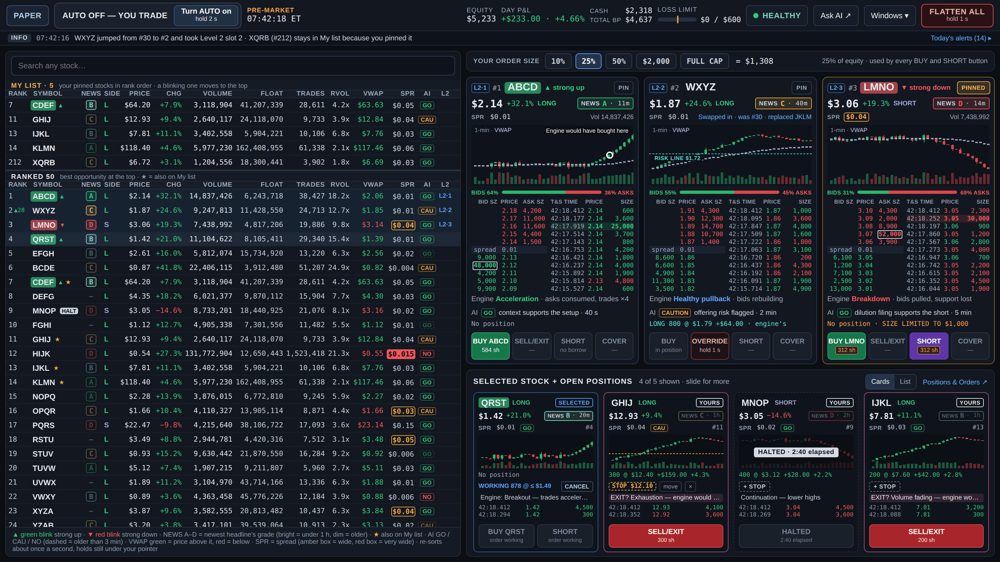

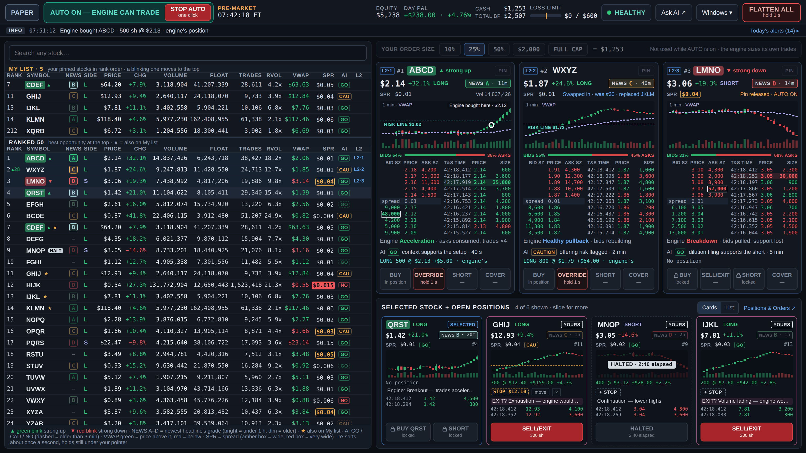

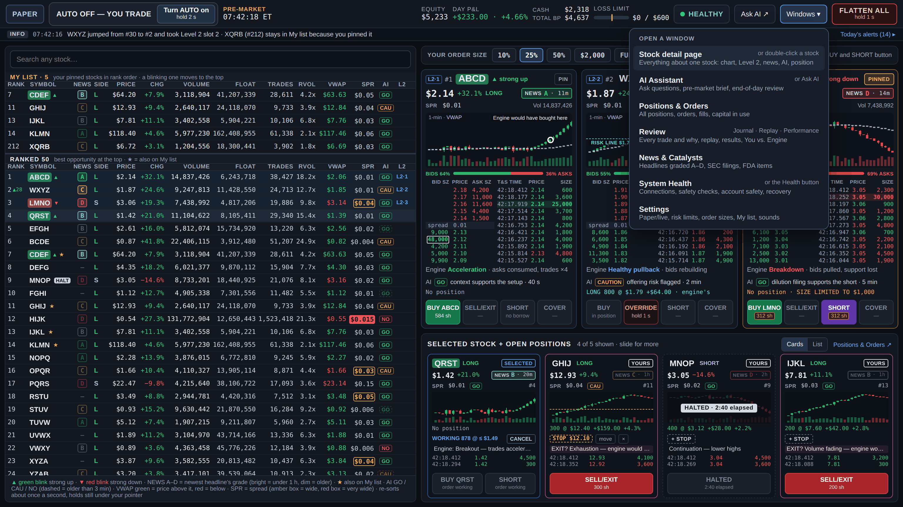

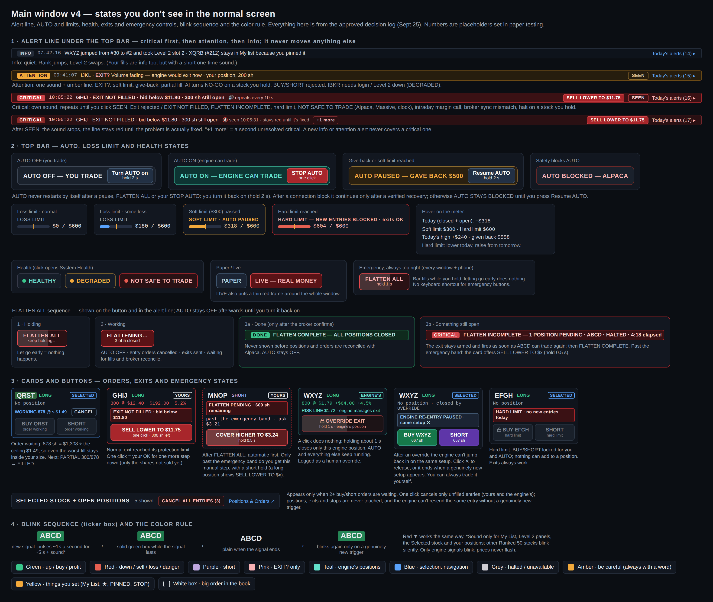

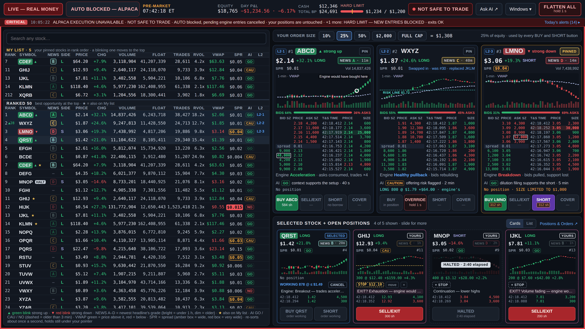

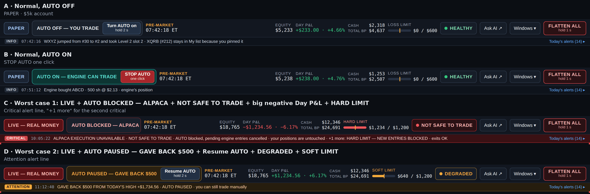

# 5. Every separate window: the thin top bar and the pop-up trade card

There are seven separate windows, opened from Windows ▾ (and the shortcuts listed per window): Stock detail, AI Assistant, Positions & Orders, Review, News & Catalysts, System Health, Settings. On one laptop screen a window covers the main window; the main window keeps running behind it and never closes. Closing any window stops nothing. Every separate window has the thin top bar and the 22 px alert line, and every ticker in it opens the pop-up trade card.

## 5.1 The thin top bar (mockup T1)

**Left to right:** ← MAIN WINDOW button (big, blue, always the same top-left spot) with the F2 key · window name · PAPER / LIVE — REAL MONEY · AUTO state · session clock · LIVE ALERTS label + blink chips · DAY P&L (+ limit tag) · health word · Windows ▾ · FLATTEN ALL. The 22 px alert line sits directly under it.

- ← MAIN WINDOW or F2 brings the main window to the front instantly (nothing has to load). F2 is the starting key (Settings can change it).
- **AUTO in words:** "AUTO OFF — YOU TRADE" · "AUTO ON — ENGINE CAN TRADE" + **STOP AUTO (one click)** · "AUTO PAUSED — reason" · "AUTO BLOCKED — reason" (short reason word — ALPACA, BROKER SYNC, ORDER LIMIT …; the full reason is in the alert line) · "AUTO STAYS BLOCKED — press Resume AUTO". Turning AUTO on and Resume AUTO happen only in the main window; the paused block's hover says "Resume AUTO in the main window".
- **Session clock:** "PRE-MARKET 07:42 ET" (REGULAR, AFTER-HOURS, MARKET CLOSED).
- **Blink chips:** only for stocks that matter to you — My list, the Level 2 slots, the Selected stock and **all open positions (yours and the engine's)**. A teal underline marks an engine position's chip. EXIT? chips (your positions only) come first. Newest 3 shown, then "+N more". A chip blinks about 5 s, stays solid while the signal is active, and disappears when it ends. **Click a chip = pop-up trade card.**
- **Limit tag:** a small "SOFT LIMIT" (amber) or "HARD LIMIT" (red) next to Day P&L, only when reached.
- **Health word:** HEALTHY / DEGRADED / NOT SAFE TO TRADE with the same hover as the main window; click opens System Health.
- **LIVE frame:** the red LIVE frame surrounds every window, not only the main one.
- **Fit rule:** nothing wraps; FLATTEN ALL can never be pushed off. When space runs out: (1) the window name shortens (ellipsis, down to about 60 px), (2) chips shorten to arrow + ticker ("▲ ABCD"), (3) the "LIVE ALERTS" label hides, (4) chips drop into "+N more". **Safety states never disappear to save space:** PAPER/LIVE, AUTO BLOCKED/PAUSED, SOFT/HARD LIMIT when active, the health word and FLATTEN ALL always stay; when the bar wording is short, the full reason is in the alert line. Chip count and timings are TEST values.
- Tested states (T1): normal PAPER AUTO OFF (2 chips); AUTO ON with an engine-position chip (3 shown, +1 more); LIVE soft limit AUTO PAUSED DEGRADED; the longest — LIVE, AUTO BLOCKED — ALPACA, HARD LIMIT, NOT SAFE TO TRADE, 6 signals (2 shown, +4 more); order circuit breaker "AUTO BLOCKED — ORDER LIMIT"; long window name, AUTO ON, after-hours. All fit; FLATTEN ALL ends 10 px from the edge.

## 5.2 The pop-up trade card (mockups C1, C2)

**Opens from:** any ticker in any separate window (a headline, the AI chat, Review, Positions & Orders, Stock detail links) and any blink chip in the thin top bar. Not from the main window's list (there, click = Selected card). **The buy is always the second click, on the card**, so opening a card can never place an order. Double-click on a ticker opens Stock detail instead of the card.

**Behavior**

- It is the same component as the strip card (consistency rule): same states, same rules, same order path and risk checks — the card adds no load to the engine.
- One card at a time: another ticker click replaces it. It opens next to the click, never covers the top bar or the alert line, and can be dragged by its header.
- Close with ✕ or Esc. **Closing the card never cancels a working order**; the order keeps going and stays visible in the strip and in Positions & Orders.
- Its buttons are locked about 0.5 s after opening (TEST), shaded "opening…", so a double-click on a ticker can never land on BUY.
- Opened from Review, a Replay moment or a historical AI answer, the header is blue: **"LIVE CARD · CURRENT MARKET · now 07:42:31 ET"**, so a historical price is never mistaken for a tradable one; the replay pauses while it is open ("Replay paused at 07:12:52.100 · prices here are live, not from the replay").

**Content (top to bottom, mockup C1)**

1. Header: "TRADE CARD" · ticker box (blinks on a signal) · signal text · rank · Level 2 slot or "no Level 2 slot" · owner chip · "Full page ↗" (Stock detail) · ✕.
2. Price line: price, change, LONG/SHORT setup, "NEWS A · 11m", SPR (with box rule), "AI GO · 40 s" (OLD after 3 min).
3. Small chart: 1-minute candles, VWAP, volume; "YOUR ENTRY $2.15" and your STOP line, or the engine's RISK LINE; the engine marker.
4. Engine line (state + reason; "○ would have bought $2.12 · AUTO off").
5. AI line (verdict + main reason + age).
6. Position line: owner chip, shares @ average, P&L $ and %, "+ STOP" or "STOP $1.95 · move · ×".
7. Order status line with its action: "PARTIAL 300 / 521 · WORKING ≤ $2.24 · size limited by cash" + CANCEL.
8. Order size bar: SIZE 10% · 25% · 50% · $2,000 · FULL CAP "= $1,308" · "same size everywhere" (dimmed in AUTO ON).
9. Four buttons: BUY · SELL/EXIT · SHORT · COVER (always, same places).
10. Footer: "Same card and rules as the main window…" (drawing note; the built card may shorten it).

**States (mockup C2) — exact wording**

| State | What the card shows |
|---|---|
| Engine entry working (AUTO ON) | "ENGINE BUY 200 / 500 · working ≤ $2.31" + "CANCEL ENGINE ENTRY · hold 1 s"; BUY "AUTO ON", SELL/EXIT "🔒 engine's · 200 sh"; after cancelling: "ENGINE RE-ENTRY PAUSED · same setup ×" |
| Engine's position | "700 @ $1.79 · +$56.00 · RISK LINE $1.72 · engine manages exit"; BUY "in position"; "OVERRIDE EXIT · 🔒 hold 1 s" |
| Opened outside the platform | "YOURS · OPENED OUTSIDE PLATFORM"; BUY "in position"; SELL/EXIT one click |
| EXIT NOT FILLED | "EXIT NOT FILLED · bid below $7.52 · 172 sh left"; "SELL LOWER TO $7.48 · one click" |
| Halted | "HALTED · 2:40 elapsed · no official resume time yet"; exit button "HALTED"; pressing it queues the exit → "COVER PENDING · sends when trading resumes" (SELL/EXIT PENDING for a long) |
| Closed | "CLOSED · +$64.00 · 100 sh sold @ $13.04 · yours" for about 5 s (TEST), then "No position"; the card stays open |
| Hard daily limit | "HARD LIMIT — NEW ENTRIES BLOCKED · exits OK"; BUY "blocked · hard limit" |
| Intraday margin call | "MARGIN CALL · $412 · BUY/SHORT blocked" + "EST. SELL 61 ABCD TO CURE MARGIN" (runs only on your click); SELL/EXIT active |
| NOT SAFE TO TRADE | "ALPACA EXECUTION UNAVAILABLE · orders can't be sent"; all buttons "can't send"; "Manual backup: use Alpaca directly" only when only our link failed. With Massive stale instead: BUY/SHORT refused, exits available |
| One stock out of sync | "ABCD BLOCKED — BROKER SYNC · platform 300 · Alpaca 400"; SELL/EXIT uses Alpaca's 400 |
| UNKNOWN order | "UNKNOWN · checking with Alpaca · sell 100 sent 07:50:02"; BUY "waits for Alpaca"; SELL/EXIT "checking…" |
| Not eligible | the four buttons are replaced by "NOT ELIGIBLE FOR PLATFORM TRADING · OTC stock · not tradable at Alpaca · data only" |
| Size limited / FULL CAP | amber box "312 sh · $1,000 cap"; FULL CAP selected → amber frame, "= up to $2,318" |
| AUTO ON | size bar dimmed "Not used while AUTO is on · the engine sizes its own trades"; BUY/SHORT "AUTO ON"; your exits active |
| SHORT wording | Phase 1 "SHORT · off · long-only" (the SHORTS OFF state) → Phase 3 "SHORT LMNO · 400 sh" or "SHORT · no borrow" |
| Just opened | all four buttons hatched "opening…" for about 0.5 s |
| Order statuses | RISK CHECK… → SENT → WORKING 583 @ ≤ $2.24 · CANCEL → PARTIAL 300 / 583 → FILLED · NOT FILLED · price ran above $2.24 · REJECTED · reason · UNKNOWN · checking with Alpaca · CANCELLED · by you |

## 5.3 Acceptance checks — thin bar and trade card

- **TB-01** Every separate window shows the thin bar and alert line; ← MAIN WINDOW and F2 bring the main window forward instantly.
- **TB-02** STOP AUTO works in one click from every window; Turn AUTO on / Resume AUTO are not available outside the main window.
- **TB-03** In every T1 state nothing wraps, FLATTEN ALL stays fully visible, and the safety states stay visible; shrinking follows the four steps in order.
- **TB-04** Chips appear only for the defined stock group (including engine positions), EXIT? first, max 3 + "+N more"; a chip click opens the trade card.
- **TC-01** Clicking any ticker or chip opens the card; nothing is ordered until a button on the card is clicked; buttons are locked during the opening lock.
- **TC-02** Every state in the C2 table appears with the exact wording and the same behavior as the strip card, Level 2 panel and Stock detail.
- **TC-03** Closing the card (✕ / Esc) never cancels or changes an order.
- **TC-04** A card opened from Review or historical AI context is headed "LIVE CARD · CURRENT MARKET" with the current time, and the replay pauses.
- **TC-05** One card at a time; it never covers the top bar or alert line; it can be dragged.

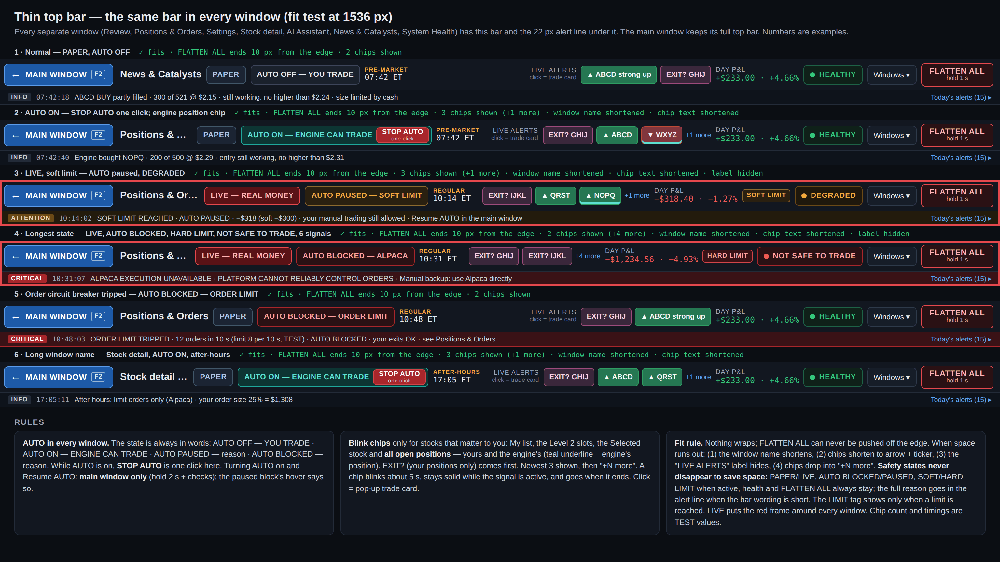

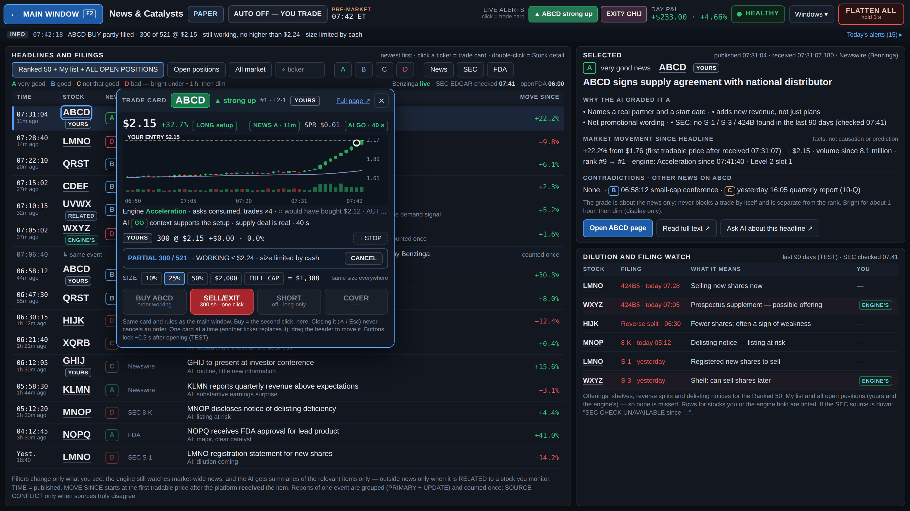

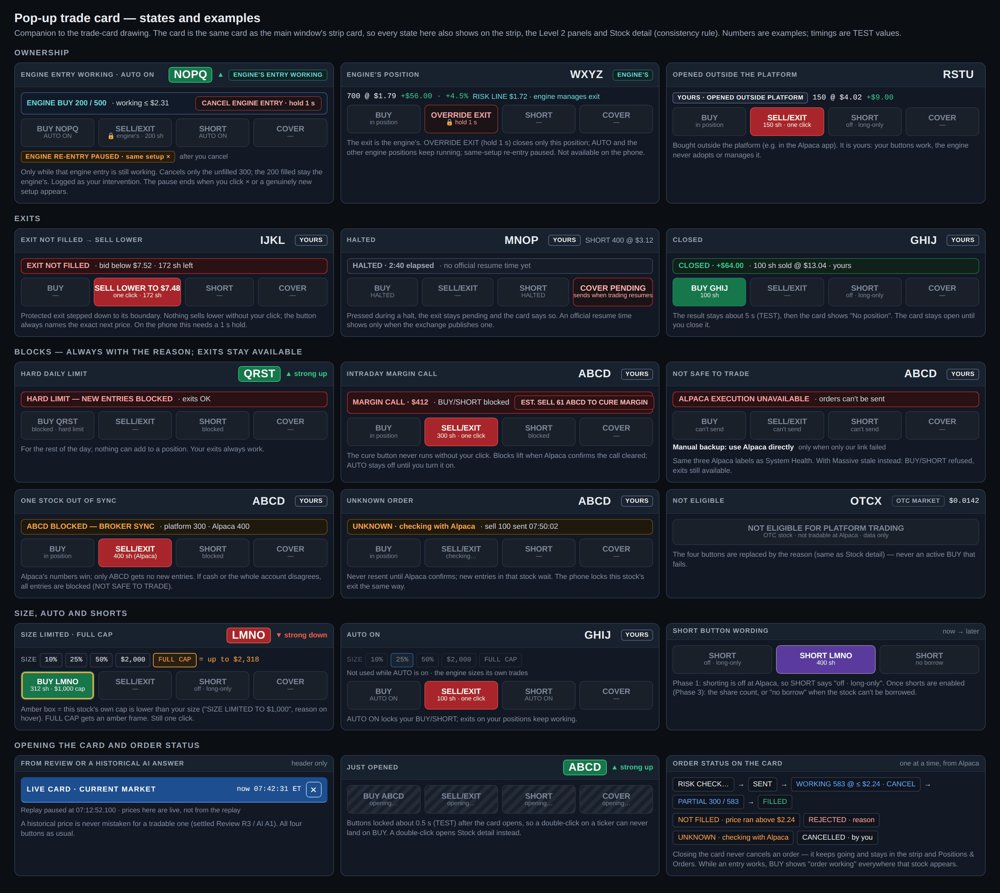

# 6. Review window (Journal · Replay · Performance)

**Purpose:** answer five questions about every trading day — what happened, why, how it performed, what the engine would have done, and how performance is changing. Replaces v3's separate Journal & Replay and Performance windows. Opens from Windows ▾, "why" links (Positions & Orders, Stock detail) and engine-event source chips in AI answers. "Ask AI about this trade" is a button inside Review that opens the AI Assistant. Opens on the **Journal tab, today, in the environment you are trading in**. Mockups RV1–RV4.

## 6.1 Whole window

- Thin top bar ("Review") + alert line, so a Critical alert is never missed while reviewing.
- Tabs **JOURNAL · REPLAY · PERFORMANCE**; the selected trade stays selected across tabs.
- Day picker for Journal and Replay ("◂ FRI SEP 25, 2026 ▸ · Today"); Performance picks a period.
- **SHOWING RESULTS: PAPER | LIVE | RESEARCH** — a results filter only, never the trading-mode switch; changing it never changes the account. Results are never added together. LIVE results look like LIVE (red). When the filter differs from the mode you are trading in, a note says so ("viewing PAPER results · you are trading LIVE"). RESEARCH shows Phase 0 runs (chapter 15).
- Clicking a ticker opens the pop-up trade card ("LIVE CARD · CURRENT MARKET"), never an order. Replay is read-only.
- All results are after commissions, fees and slippage. The engine's would-have trades use estimated fills, are always labeled (dashed WOULD-HAVE chip, "est.") and are never counted in account P&L.
- **WOULD-HAVE** = only new engine entries it was not allowed to place because AUTO was off. An engine position opened before AUTO went off stays a real ENGINE trade, including its exits; a partly filled entry's filled shares are ENGINE.

## 6.2 Journal tab (RV1)

- **TRADES** table, one row per round trip: TIME · SYMBOL · SIDE · OWNER (YOU / ENGINE / WOULD-HAVE) · SETUP · SH · ENTRY · EXIT · P&L · R · CLOSED BY · RESULT. Summary line (real vs would-have, realized, open, fees, day total) and result-type totals under the table.
- **R** for your trades shows "—" unless you set a stop or planned risk before entry (no default risk); You vs Engine compares in dollars after costs.
- **CLOSED BY:** YOU · YOUR STOP · ENGINE · OVERRIDE EXIT · FLATTEN ALL · CLOSED BY ALPACA · MARGIN.
- **RESULT** (File 4 §16): win · valid strategy loss · execution / slippage · market regime · technical failure · rule break. Colored by the attention it needs: win green, valid strategy loss plain (its negative P&L stays red), execution / regime amber, technical / rule break red.
- Filters: All · Yours · Engine's · Would-have · Losses · Overrides & flattens · ticker search. **EXPORT CSV** (trades + fills, for reconciliation and taxes).
- **MISSED RUNNERS:** move, first seen, why missed (Level 2 slots busy, spread, signal late, promoted late, buying power, no borrow, human timing). A stock counts as a missed runner only by a predefined, versioned rule using what the platform could have known at the time and prices that were actually tradable — never just "it went up a lot later". Runners that gave no usable warning are counted separately as "not catchable". Exact rule and thresholds OPEN.
- **DAY EVENTS** and **BLOCKED & REJECTED** (small tabs): mode changes, pauses and resumes, OVERRIDE EXIT, FLATTEN ALL reports, halts on held stocks, connection incidents (the three Alpaca labels), margin calls — the day's alert history kept for good. Blocked & rejected = every entry refused and why (hard limit, margin headroom, no borrow, NOT SAFE, CANCEL ALL ENTRIES, broker rejection, NOT FILLED, order limit).
- **WHY panel** for the selected trade: entry (click or trigger, size and how it was worked out, fill and slippage) · ORDER TRAIL (ms, Alpaca) · what the engine saw (rank, Level 2 slot, engine state, AI verdict + age, news grade + age) · YOU VS ENGINE on that trade (the engine's would-have in / out / result) · exit and who closed it (SELL LOWER clicks shown) · best / worst point (MFE / MAE) · capture · versions and data sources. Buttons: **▶ REPLAY THIS TRADE** · **Ask AI about this trade**.
- An optional one-line personal note per trade (never interrupts trading).

## 6.3 Replay tab (RV2, RV3)

- Replay a trade (default: the selected one), a missed runner, or a time window of any stock (a whole day is possible).
- Big chart (ticks / 5 s / 1 min): buy and sell marks, signal time, ceiling, risk line or your stop, VWAP, volume, Level 2 slot in / out, halts, data gaps marked with their source. On your trades the engine's would-have marks are shown too.
- Level 2 book + Time & Sales exactly as they were at the replay moment (same look as the main panels). A stock with no slot shows "NO LEVEL 2 RECORDED".
- **AT THIS MOMENT:** engine state and reasons, exit check, AI verdict + age, position, account (cash, BP at 1×, margin, loss vs limit).
- **EVENT TIMELINE** to the millisecond, each line tagged with its source (MASSIVE / IBKR / ALPACA / ENGINE / RISK / AI / YOU); click a line to jump there.
- Controls: start · step back · play / pause · step · speed 0.25× / 1× / 5× / 20× · jump to signal / entry / exit / next event · scrubber with event ticks.
- Header: versions used (model · risk · AI) + **"MATCHES RECORDED LIVE ✓"** (deterministic replay reproduced the recorded live decision and result; not a claim that every source was complete) + gap count when there is one ("· 1 DATA GAP") + "READ-ONLY · NO ORDERS". A mismatch shows "DOES NOT MATCH RECORDED LIVE" and is logged as a bug.
- A trade card opened from Replay is the "LIVE CARD · CURRENT MARKET" card with all four buttons; the replay pauses while it is open (RV3).
- How far back Replay can go depends on the raw tick / Level 2 retention policy (OPEN).

## 6.4 Performance tab (RV4)

- Filters: PERIOD (Today · This week · Last 30 days · All · Custom…) · OWNER (All · You · Engine) · PAPER | LIVE | RESEARCH.
- Key numbers: net P&L after costs · expectancy (R and $) · win rate (never judged alone) · average win / loss · profit factor · max drawdown · capture · trades (no quota).
- Account over time after costs + each day's P&L.
- **YOU VS. ENGINE:** your trades vs the engine's would-have trades on the same stocks (trades, win rate, net, per trade, your entry timing vs the engine's, your exits vs the engine's); OVERRIDE EXIT counted on its own (result vs if the engine had kept them).
- **SPLIT BY ▾:** setup · price band · float · session · long / short · news grade · spread · strategy version.
- **ENGINE ALONE VS. ENGINE + AI:** win rate, expectancy, bad trades avoided, good trades blocked, AI delay. The AI stays only if it improves results after costs.
- **WHERE LOSSES CAME FROM** (result types in $) + missed runners (top movers caught early, why missed).
- **EXECUTION & ACCOUNT SAFETY:** slippage on entries / exits, signal → fill latency, NOT FILLED count, fees / borrow, "INTRADAY MARGIN CALLS: 0 — TARGET 0", AUTO pauses (soft / give-back), hard-limit days, FLATTEN ALL uses, connection incidents.
- A placeholder notice shows until real paper results exist; example numbers are never targets.

## 6.5 Acceptance checks — Review

- **RV-01** Journal lists every real trade and every would-have trade with the correct owner, CLOSED BY and RESULT; totals after costs match Positions & Orders' realized and fees for the day.
- **RV-02** The results filter never changes the trading mode, never adds PAPER, LIVE and RESEARCH together, and shows the mismatch note.
- **RV-03** Replay of a recorded live trade reproduces the recorded decision ("MATCHES RECORDED LIVE ✓"); gaps are counted and shown; a mismatch is logged as a bug.
- **RV-04** Event timeline lines carry their source and millisecond time; clicking jumps the replay.
- **RV-05** Missed runners follow the predefined, versioned rule; "not catchable" runners are separate.
- **RV-06** A card opened from Replay is headed "LIVE CARD · CURRENT MARKET", pauses the replay, and shows live prices with all four buttons.
- **RV-07** EXPORT CSV contains trades and fills that reconcile with Alpaca.

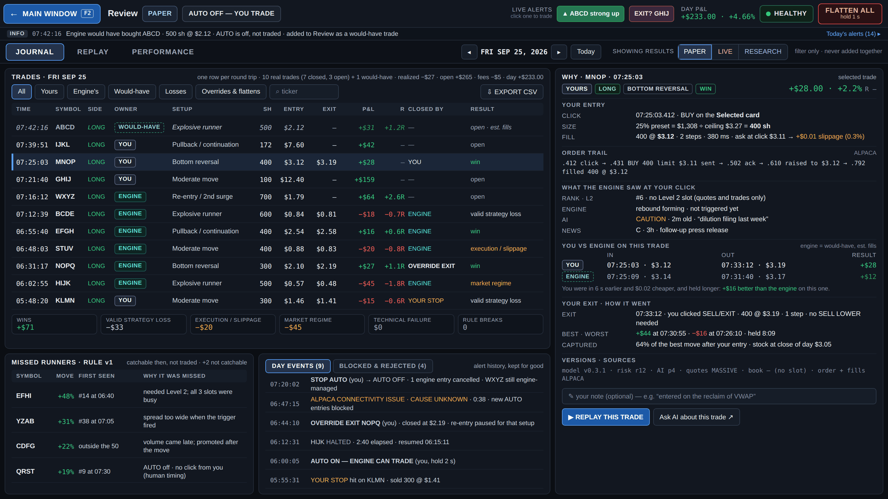

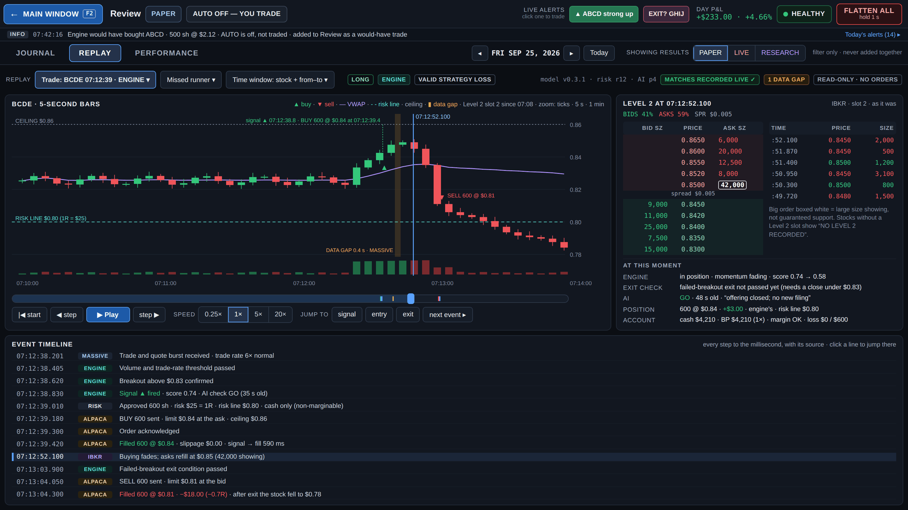

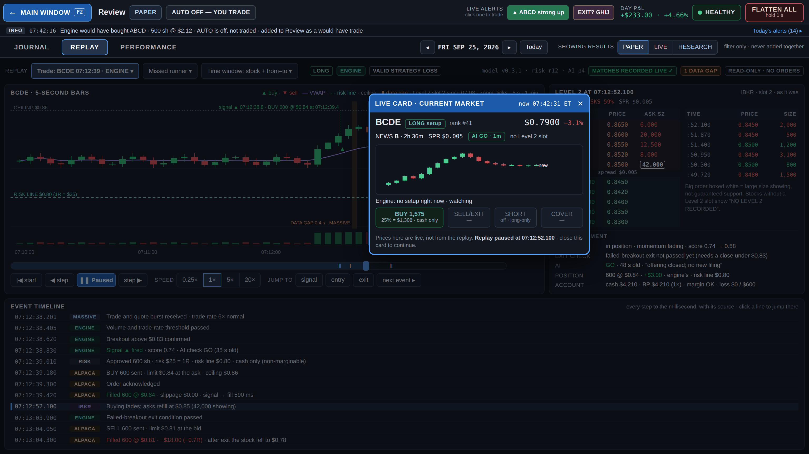

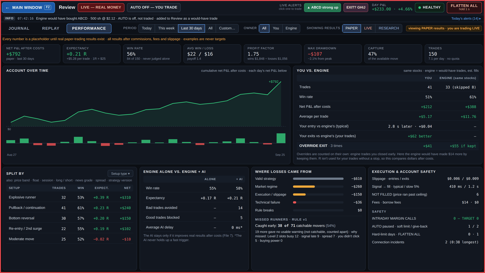

# 7. Positions & Orders window

**Purpose:** everything that really happened at Alpaca in the mode you are trading in — positions, working orders, fills, capital in use, reconciliation. Opens from Windows ▾ and "Positions & Orders ↗" on the strip. Mockups PO1 (normal day, PAPER, AUTO OFF), PO2 (flatten incomplete, LIVE), PO3 (states and examples).

## 7.1 Whole window

- Thin top bar ("Positions & Orders") + alert line.
- Only **real** positions and orders of the mode you are trading in (PAPER or LIVE). The engine's would-have trades stay in Review.
- Exact cents everywhere (whole dollars are only for the top bar's fit). Ticker click = pop-up trade card. No order hotkeys.

## 7.2 Account strip (one row)

EQUITY · CASH / HELD FOR WORKING ORDERS / AVAILABLE FOR NEW ORDERS · LEVERAGE ("1× · Alpaca 1× · platform 1× · long-only"; later for example "1.5× · SHORTS ENABLED" when approved) · LONG / SHORT VALUE (short: "— shorts off" until Phase 3) · OPEN P&L · REALIZED + FEES · DAY P&L (the same number as the top bar) · LOSS LIMIT meter (soft / hard) · MARGIN tile ("HEADROOM OK" / "HEADROOM LOW · NEW SIZE REDUCED" / "INTRADAY MARGIN CALL"; "margin calls: 0 — TARGET 0").

- "Available for new orders" is account-level ("Available (account total)"); the amount usable for a given stock can be lower (marginability, borrow, reserve, caps). The real per-stock amount is the share count on each BUY/SHORT button; the tile's hover says so. It makes 1× visible: after a few positions the cash is used and the next BUY shows LIMITED by cash (drawn: ABCD 25% = $1,308 → $1,167.80 ÷ ceiling $2.24 = 521 sh).

## 7.3 Open positions

- YOURS first, then ENGINE'S — labeled dividers that say who closes them — each group in the order opened (same as the strip).
- Columns: SYMBOL · SIDE · OWNER · SH · AVG · LAST · P&L $ · P&L % · STOP (yours: "STOP $13.40 · move · ×" or "+ STOP") / RISK LINE (engine's) · OPENED + time held · ENGINE'S READ (EXIT? on yours = advice only) · ORDER STATUS · EXIT.
- Exit button = the card rules: SELL/EXIT one click on yours (also in AUTO ON) · 🔒 "OVERRIDE EXIT · hold 1 s" on the engine's · "HALTED · elapsed" · "SELL LOWER TO $x" (one click on a normal exit; hold 0.5 s past the FLATTEN band) · "checking…" while an exit is UNKNOWN · CLOSED (the row stays about 5 s).
- Owner chip "YOURS · OPENED OUTSIDE PLATFORM" for a position found at Alpaca that the platform did not open (your SELL/EXIT works; the engine never manages it).
- No SELL HALF here.
- **During FLATTEN ALL** the positions panel becomes the flatten report (PO2): banner "FLATTEN INCOMPLETE — n POSITIONS PENDING …", pending rows first, closed rows listed until the flatten finishes; "FLATTEN COMPLETE" only when Alpaca shows zero positions too.

## 7.4 Working orders

- Every working order including your STOP: sent time, symbol, order (side, type, entry / exit / stop), owner, filled / total, status, CANCEL on your own orders (move · × on your stop). Each row shows its trail (sent → raised → partial → … → ceiling) and why the size was limited.
- Header: "CANCEL ALL ENTRIES (n)" with 2+ unfilled entries.
- A working **engine entry** has "CANCEL ENGINE ENTRY · hold 1 s": only that order's unfilled shares are cancelled; filled shares stay an ENGINE position; logged as a human intervention; "ENGINE RE-ENTRY PAUSED · same setup ×" until you release it or a genuinely new setup appears. The button shows only while that engine entry is working.
- The engine's exits can never be cancelled by you (OVERRIDE EXIT instead).
- Statuses and UNKNOWN handling as in section 2.11.

## 7.5 Fills & orders today

Tabs FILLS · ALL ORDERS · PROBLEMS · REALLOCATIONS, newest first, times to the millisecond, from Alpaca, with notes (partial, OVERRIDE EXIT by you, FLATTEN ALL, CLOSED BY ALPACA · MARGIN). PROBLEMS = rejected, NOT FILLED, cancelled by the system, UNKNOWN. Click a row = full trail; "why" opens Review.

## 7.6 Today by owner

YOURS · ENGINE'S · TOTAL — open, open P&L, realized, fees, day P&L. Real trades only. An OVERRIDE EXIT counts under the engine (its trade), with a note.

## 7.7 Broker check · Alpaca

IN SYNC / CHECKING / MISMATCH with the last check time and "check now". Runs after every fill, every reconnect, at start-up and every few seconds (interval TEST). Alpaca's numbers win. Two mismatch levels (section 2.11): one stock → that stock blocked for new entries; account-level → all new entries blocked (AUTO BLOCKED — BROKER SYNC). Exits always work; Critical alert; incident logged in Review. After a restart everything is rebuilt from Alpaca, never assumed empty.

## 7.8 Reallocations (engine only)

Reserve → trim weakest → close weakest, each with its reason. Your positions are never trimmed or sold to make room. Reserve size TEST.

## 7.9 Margin call view (PO3)

Amount, since when, Alpaca deadline, goal today; the estimated cure button for your positions, recalculated live ("EST. SELL 61 ABCD TO CURE MARGIN · covers the remaining $130"); after its fill the platform re-checks Alpaca and recalculates any remainder; what the engine already sold of its own; AUTO + your BUY/SHORT blocked, exits available, working entries cancelled. The call is cured only when Alpaca confirms.

## 7.10 Shorts later (Phase 3)

SIDE in purple, COVER instead of SELL/EXIT, borrow status and fee from Alpaca on the row (easy / hard to borrow).

## 7.11 Acceptance checks — Positions & Orders

- **PO-01** Every position and order at Alpaca appears here within the broker-check interval, with the correct owner; nothing that did not happen at Alpaca appears.
- **PO-02** Equity, cash, held, available, open P&L, realized, fees and Day P&L add up and match the top bar and Alpaca to the cent.
- **PO-03** Each exit button behaves exactly like the card's; OVERRIDE EXIT and CANCEL ENGINE ENTRY need a 1 s hold and are logged.
- **PO-04** A forced mismatch (test) produces the correct level (one stock vs account), blocks the right entries, keeps exits working and logs an incident.
- **PO-05** During FLATTEN ALL the panel becomes the flatten report and shows FLATTEN COMPLETE only after Alpaca shows zero positions.
- **PO-06** A position opened in the Alpaca app appears as "YOURS · OPENED OUTSIDE PLATFORM" and is never managed by the engine.
- **PO-07** The margin cure button recalculates live and never runs without a click; the call clears only on Alpaca's confirmation.

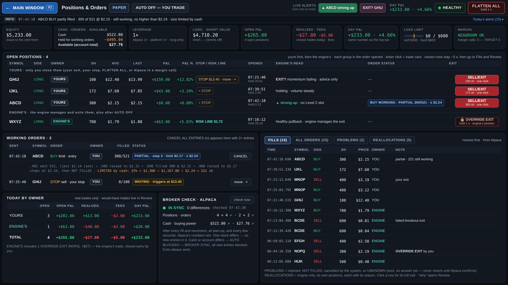

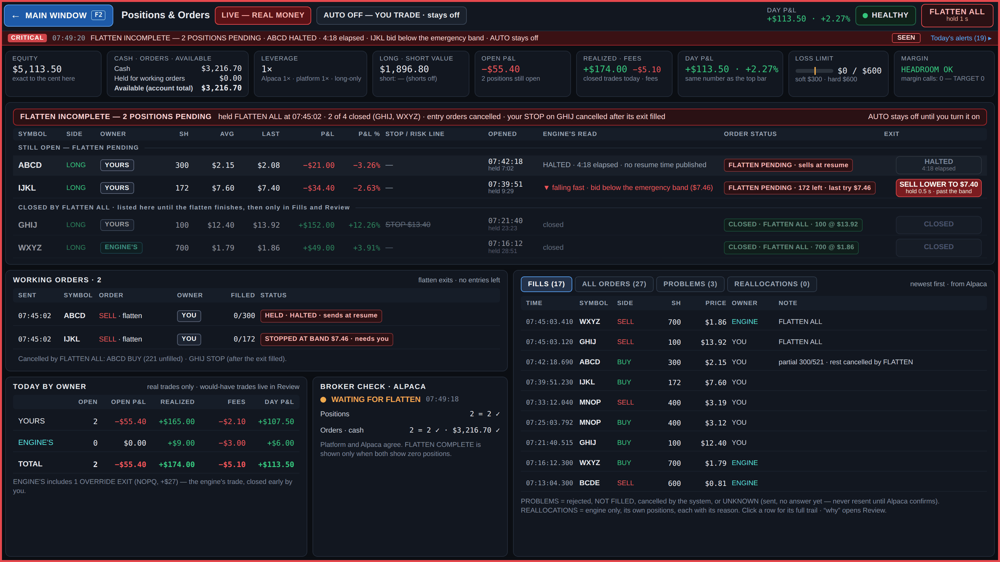

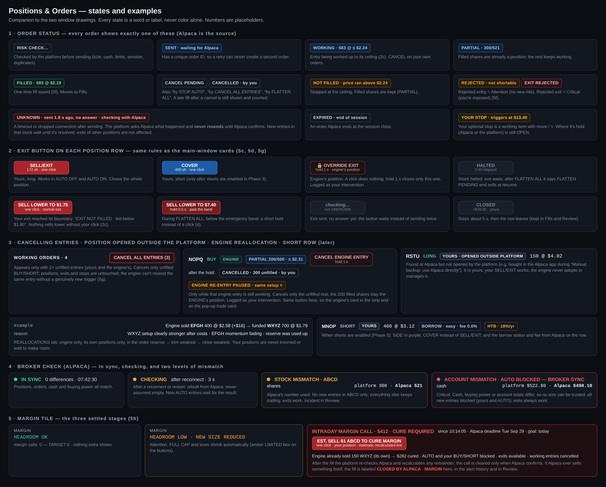

# 8. Settings window

**Purpose:** every adjustable value, with a clear rule for when a change counts, protected and logged. Opens from Windows ▾. Mockups SET1 (Trading & risk), SET2 (Engine & connections), SET3 (Screen & sounds). All values in the drawings are examples or starting values.

## 8.1 How Settings works

- Thin top bar ("Settings") + alert line. Left: section list in three pages — TRADING & RISK · ENGINE & CONNECTIONS · SCREEN & SOUNDS — plus CHANGE HISTORY.
- **EDITING SETTINGS FOR [PAPER | LIVE]** at the top: PAPER and LIVE keep separate setting sets; changing PAPER never changes LIVE; this switch never changes the trading mode. "Copy PAPER values to LIVE…" counts as a LIVE change (riskier parts scheduled + PIN). The only exception is page 3's SHARED block (look and preferences — 8.4), which is the same in both sets; page 3's alert, signal-sound and spread-warning settings are separate like everything else.
- **Badge on every setting — when a change counts:**
  - **NOW** — at once, for new decisions from now on.
  - **RISKIER → NEXT DAY** — in LIVE, safer changes at once; risk-raising changes (loss limits up, leverage up, bigger presets or caps, more slippage, a strategy on) take effect the next trading day (4:00 a.m. ET) and need hold + PIN.
  - **🔒 LOCKED** — a safety rule, not editable here.
  - **TEST value** — a dashed value box, separate from the badge, for every number that is not proven ("TEST $300"); "NOT SET YET · TESTING" where no value exists yet.
- In PAPER every change applies at once (fast testing); the next-day rule is for LIVE.
- **"NOW" means for new decisions:** a change never rewrites an order already working and never closes a position (example: max positions 6 → 4 while holding 5 blocks new entries until below 4; nothing is sold).
- A risk-raising LIVE change shows as SCHEDULED with its effective time and a cancel button, and in the alert line ("Settings: LIVE hard loss limit raise $600 → $800 scheduled for the next trading day (Mon Sep 28, 4:00 a.m. ET) · PIN confirmed").
- **PIN** (plus hold) for switching to LIVE, raising risk in LIVE, promoting a new version and a broker switch.
- **Every change is logged** in CHANGE HISTORY (time, PAPER / LIVE, old → new, when it takes effect), kept for good; risk changes also appear in Review's Day events. The engine and the AI can never change a setting.
- A failure never changes a setting: the setting stays ON and the row shows "ON · UNAVAILABLE — IBKR L2 DOWN"; recovery follows the recovery rules, never a silent toggle.

## 8.2 Page 1 — Trading & risk (SET1)

- **Trading mode:** PAPER / LIVE (LIVE = hold 2 s + PIN + every start-up check; LIVE starts on the smallest preset; red frame).
- **Loss limits:** soft (AUTO pauses) · hard (all new entries blocked, no Resume AUTO that day) · give-back from today's high · recovery buffer before a new soft-limit pause. All count closed + open (= Day P&L). Hard limit lowered now, raised next trading day.
- **Leverage & shorts:** leverage 1× (Alpaca and platform must match; lower now, raise next day) · short selling OFF and 🔒 LOCKED (Alpaca long-only until Phase 3) · safety reserve (TEST) · "LIVE rollout: Phase 1 of 4" · "margin calls 0 — TARGET 0" (view).
- **Hard caps:** most in one stock (also caps FULL CAP) · most open positions · engine risk per trade (1R) · engine reserve for better setups · liquidity cap (engine side, 🔒).
- **Order size:** 10% · 25% · 50% · $2,000 editable with today's dollar value; FULL CAP 🔒 (the most the limits allow); start-up rule 🔒 (LIVE smallest, PAPER remembers). Changing sizes never touches a working order.
- **Execution:** your maximum slippage on entries (the ceiling can never pass it) · exit boundary for normal exits (then EXIT NOT FILLED + SELL LOWER) · FLATTEN ALL emergency band (TEST) · "UNPROTECTED MARKET ORDERS: PROHIBITED 🔒" (protected marketable-limit execution continues; mechanics set by testing).
- **Change history** panel on page 1.

## 8.3 Page 2 — Engine & connections (SET2)

- **Strategies:** long engine · Level 2 strategies (if IBKR Level 2 is down: stays ON and shows "UNAVAILABLE — IBKR L2 DOWN"; your setting is never changed) · short engine "PAPER ONLY" 🔒 until proven (Phase 3) · AI context check (stays only if it improves results after costs). Turning one off is always immediate. Each strategy declares the sources it needs.
- **Versions:** strategy / model, risk config, AI prompt set — each approved, with its last full test. A challenger can run in **SHADOW** (sees everything, sends no orders, compared in Review). **ROLL BACK** to the previous approved version. **PROMOTE** needs tests passed + hold 2 s + PIN. Never automatic: retraining never replaces the live version by itself.
- **AI:** mark an AI verdict as old after 3 min (display, TEST) · 🔒 the AI never holds up a fast trigger · 🔒 the Ask AI window can never place orders.
- **Connections:** ORDERS · ALPACA (masked account, e.g. "paper PA3••••9F2 · orders, fills, cash") · LEVEL 2 · IBKR (logged in · slots in use) · MARKET DATA · MASSIVE · NEWS & FILINGS (Benzinga · SEC EDGAR · openFDA) · AI SERVICE — each with status. Keys live only on the server and are never shown in full.
- **Broker setup:** "Hybrid — CURRENT (Alpaca orders & account · IBKR Level 2 · Massive data)" and "IBKR only — review around $60,000, or earlier if IBKR moves your account to the new FINRA rules · NOT AUTOMATIC", with the switch rules and preflight (section 2.2).
- **Session hours:** PRE-MARKET 4:00 a.m. · REGULAR 9:30–4:00 · AFTER-HOURS to 8:00 p.m. · OVERNIGHT OFF; official calendar with holidays and early closes; outside 9:30–4:00 only limit orders (Alpaca).
- **Phone** (settled — chapter 13): Critical alerts to the phone — always sent, cannot be turned off in LIVE 🔒 · Attention alerts — your choice (NOW) · "Phone: STOP AUTO · FLATTEN ALL · sell your own positions (hold 1 s)" 🔒 — never buys, never turns AUTO on, never switches PAPER / LIVE. The phone's own settings control notification permission.
- **Data & backups:** journal, orders and fills kept for good, never edited 🔒, backed up at least nightly (exact frequency set during construction, chapter 16) · raw ticks and Level 2 retention for Replay ("NOT SET YET · TESTING") · export trades and fills (CSV).

## 8.4 Page 3 — Screen & sounds (SET3)

Page 3 holds three kinds of setting (SETTLED Sept 29, 2026):

**🔒 LOCKED — the alert levels.** Every event's level (SIGNAL / INFO / ATTENTION / CRITICAL, section 3.4) shows as a fixed 🔒 label, not a choice. No setting in either set can change a level: a margin call or "EXIT NOT FILLED" can never be turned into a quiet alert.

**SEPARATE FOR PAPER | LIVE — anything that protects you.** This block follows the EDITING SETTINGS FOR [PAPER | LIVE] switch at the top (8.1): changing PAPER never changes LIVE, so turning a warning down while practising in PAPER never weakens it in LIVE.

- **Alerts & sounds:** each event's own sound, volume and on / off. Critical sounds 🔒: in LIVE they can be turned down but not off; they repeat about every 10 s until SEEN.
- **Signal sounds:** which stocks make a blink sound — "stocks that matter to you" (default: My list, the three Level 2 slots, the Selected stock and your positions) or all Ranked 50 — and the anti-spam interval (TEST).
- **Spread warning:** the SPR box thresholds, amber from / red from (starting 1% / 2% of price, TEST). They sit here rather than under List & display because they are a warning: loosening them in PAPER must not weaken the warning in LIVE.
- In LIVE, a change to a LIVE alert setting applies at once (NOW) — so a loud sound can be turned down mid-session — and is logged under LIVE in CHANGE HISTORY.

**SHARED — same in PAPER and LIVE (look and preferences).** Not affected by the editing switch; one value serves both sets, so switching between PAPER and LIVE never duplicates or resets them.

- **Blinks:** the blink look (about 5 s, then solid while the signal is active) and Reduced Motion (later).
- **List & display:** re-sort speed · hold the row order under the pointer · NEW tag time · NEWS bright time · back key (F2). All 14 list columns always show — there is no column chooser.
- **My list:** chips with ×, add ticker, "5 of 20" (same as ☆ in the list) — one My list for PAPER and LIVE.
- A change to a shared setting is logged in CHANGE HISTORY like every other setting, marked as shared.

## 8.5 Acceptance checks — Settings

- **SET-01** A risk-raising change in LIVE is scheduled for the next trading day, needs hold + PIN, shows SCHEDULED with cancel, and appears in the alert line and change history.
- **SET-02** A PAPER change never changes LIVE; "Copy PAPER values to LIVE" follows the LIVE rules.
- **SET-03** A NOW change affects only new decisions: no working order is rewritten and no position is closed.
- **SET-04** LOCKED rows cannot be edited; the engine and the AI cannot change any setting (attempts are refused and logged).
- **SET-05** Every change appears in CHANGE HISTORY with time, set, old → new and effective time.
- **SET-06** A provider failure never changes a setting; the row shows "ON · UNAVAILABLE — …".
- **SET-07** PROMOTE refuses a version without passed tests; ROLL BACK restores the previous approved version.
- **SET-08** Page 3: no setting in either set can change an event's level (🔒); the SEPARATE block follows the editing switch and a PAPER change never changes LIVE; the SHARED block (blinks, list & display, My list) is identical in PAPER and LIVE; in LIVE a Critical sound can be turned down but not off; a LIVE alert-setting change applies at once and is logged under LIVE.

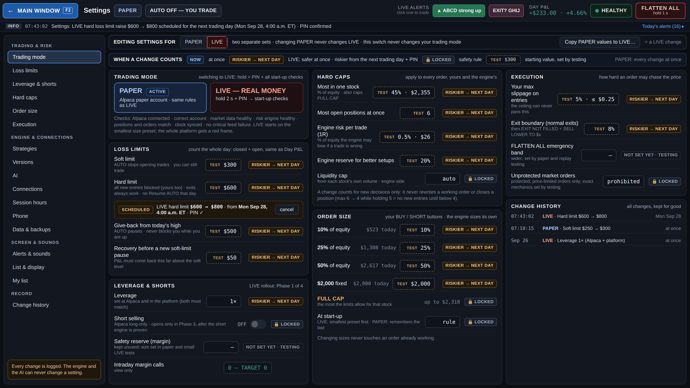

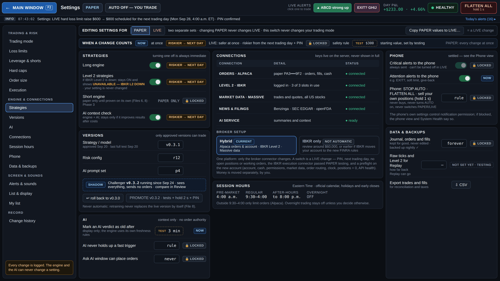

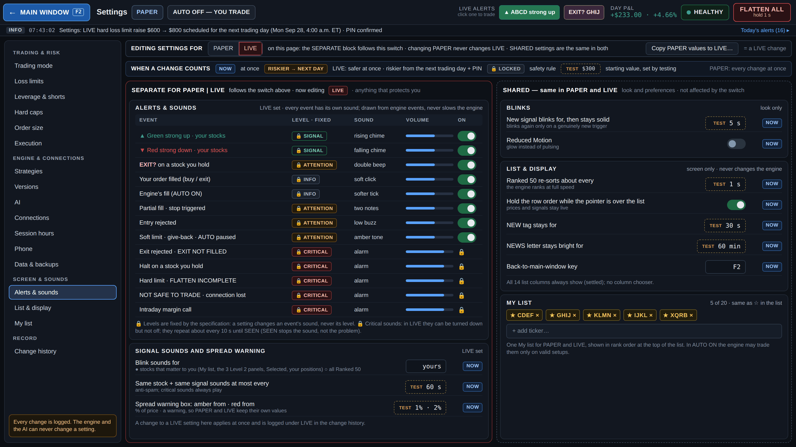

# 9. Stock detail window

**Purpose:** everything about one stock — chart, book, engine view, AI analysis, news and filings, today's journal, position — with the same trading buttons as everywhere else. Always live data (Replay lives in Review). Mockups SD1 (ABCD, your position, Level 2 slot 1, AUTO OFF, 07:42), SD2 (WXYZ, the engine's position, no Level 2 slot, AUTO ON, 07:18), SD3 (states).

## 9.1 Opening it

- Double-click a ticker (list, panel, strip) · Windows ▾ · "Full page ↗" on the pop-up trade card · the AI line on a Level 2 panel (full analysis).
- The thin top bar adds a search box **"⌕ open any ticker…"** to open any of the ~8,000 stocks.
- Search can open any symbol, but trading only eligible ones: OTC, delisted, unsupported types or Alpaca "not tradable" show whatever information exists, and the buttons read **"NOT ELIGIBLE FOR PLATFORM TRADING · reason"** — never an active BUY that fails.

## 9.2 Stock header (two rows)

- **Row 1:** symbol box with the blink rule + signal text and "since"; price; change; chips: LONG / SHORT SETUP · RANK #n with its move ("▲ from #38") · L2·n or NO LEVEL 2 SLOT · NEWS grade + exact age · SPR with the box rule · AI verdict + age (OLD after 3 min) · owner (YOURS / ENGINE'S · shares) · ☆ add / ★ My list.
- **Row 2:** the platform-wide order size (10% · 25% · 50% · $2,000 · FULL CAP "= $1,308"; changing it here changes it everywhere; dimmed in AUTO ON) + the four fixed buttons BUY · SELL/EXIT · SHORT · COVER with every card state: share count from the protected ceiling, amber LIMITED box, "order working" + CANCEL, OVERRIDE EXIT (hold 1 s) on the engine's position, CANCEL ENGINE ENTRY (hold 1 s) while an engine entry is working, locked in AUTO ON, "HALTED · elapsed", "off · long-only" while long-only, "YOURS · OPENED OUTSIDE PLATFORM". No hotkeys.

## 9.3 Chart

Timeframes 10 s · 1 m · 5 m · 15 m · 1 h · 1 D; VWAP; volume. Markers: your trades (white ▲), the engine's (teal ▲), would-have (teal ◌, AUTO OFF only); news flags A–D at the headline's time; your STOP line and your working order's ceiling; the engine's RISK LINE ("where its idea is proven wrong — not a promised exit"); shaded time in a Level 2 slot; halts shaded with elapsed time.

## 9.4 Level 2 and Time & Sales

- **In a slot:** the full book (more levels than the main panels, venue column, scroll for deeper), large orders boxed white ("showing, not guaranteed support"), pressure bar labeled as visible book pressure, not a prediction ("BIDS 58% · ASKS 42% · shown in the book now"), Time & Sales to the millisecond (large prints bold), source line "book: IBKR · trades: Massive", and why and since when it has the slot.
- **No slot:** "NO LEVEL 2 SLOT" with why (which stocks hold the three slots), the NBBO quote and Time & Sales from Massive. The trading line says what is true: **"NO LEVEL 2 SLOT · TRADING AVAILABLE"** only when Massive and Alpaca checks are healthy and the stock is eligible and not halted; otherwise the real restriction ("NOT SAFE TO TRADE — ALPACA EXECUTION UNAVAILABLE", "HALTED · 2:40 elapsed", "NOT ELIGIBLE …").
- **📌 PIN TO LEVEL 2** (AUTO OFF only, one pin at a time): puts this stock into a slot and keeps it there; the engine gives up its weakest slot that isn't showing one of your positions. States: "📌 PIN TO LEVEL 2" · "📌 PINNED · L2·2 · unpin" (stays until you unpin or AUTO turns on) · "PIN UNAVAILABLE · all slots hold your positions" · "PIN RELEASED · AUTO ON".

## 9.5 Lower panels

- **STATS** in full digits + **TRADING FLAGS:** marginable (cash only), shortable (easy / hard to borrow / no borrow), SSR, halts today, session.
- **ENGINE VIEW:** state + since, setup, signal strength ("confidence, not certainty"), why it ranks #n (factors), RANK TODAY history (e.g. #212 → #38 → #9 → #1), would-have (AUTO OFF) or, for the engine's position, entry, RISK LINE, what it is watching, "engine manages the exit · you: OVERRIDE EXIT".
- **AI ANALYSIS:** GO / CAUTION / NO-GO, confidence, age (OLD after 3 min), what makes it refresh, reasons, risk flags, contradictions (e.g. "negative filing but steady buying"), evidence sources; "Ask AI about XXXX ↗" opens the AI Assistant on this stock. Context only; never holds up the engine.
- **NEWS & FILINGS** tab: each headline with A–D grade, exact time, age and source; a fixed dilution line with source and freshness: "S-1 / S-3 / 424B: none found in last 90 days · SEC checked 07:41" ("none found" = none in the SEC search, not a guarantee; 90 days is a TEST value), or the filing ("424B5 filed 07:05 today — possible offering"), or "SEC CHECK UNAVAILABLE since 07:20 · filings unknown". Click opens News & Catalysts at that item.
- **TODAY IN XXXX** tab: this stock's journal for today — rank changes, signals, Level 2 in / out, news, AI changes, orders, fills, halts; full detail in Review.
- **POSITION:** owner, shares @ average, P&L, your STOP (none · + STOP) or the engine's RISK LINE, working orders, buy with (cash only), margin requirement for this stock from Alpaca (e.g. 100% under $2.50), short status, risk check; today's trades in this stock → Review.

## 9.6 Acceptance checks — Stock detail

- **SD-01** Any symbol can be opened; ineligible symbols never show an active BUY and state the reason.
- **SD-02** The four buttons and the size bar behave identically to the trade card and strip (every C2 state).
- **SD-03** The no-slot trading line shows TRADING AVAILABLE only when Massive and Alpaca are healthy and the stock is eligible and not halted.
- **SD-04** Pin rules hold: AUTO OFF only, one pin, never evicts a slot showing your position, released when AUTO turns on.
- **SD-05** The dilution line always shows its source check time; a stale or down SEC source is said plainly, never shown as "none".
- **SD-06** Chart markers, risk line, stop line and news flags appear at the correct times.

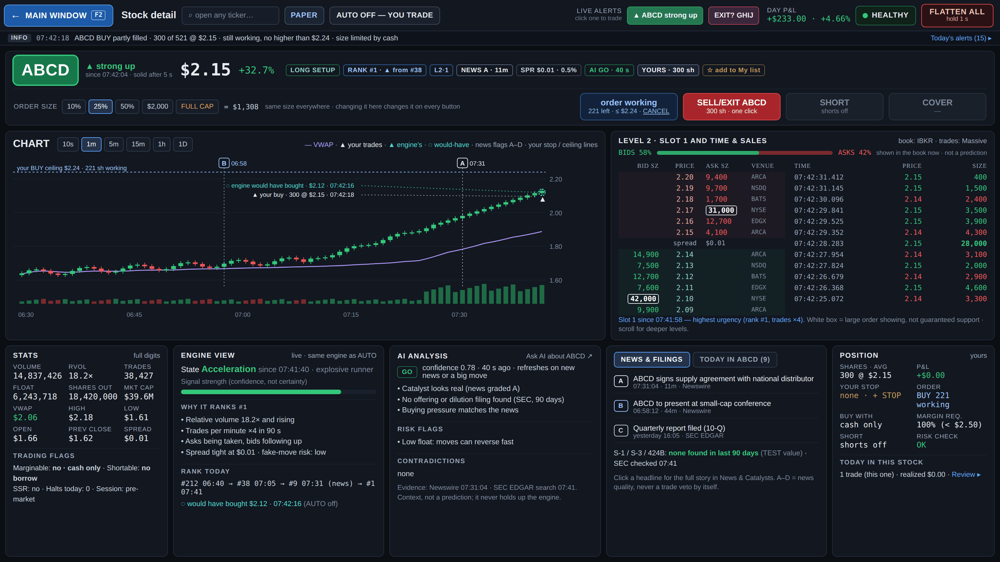

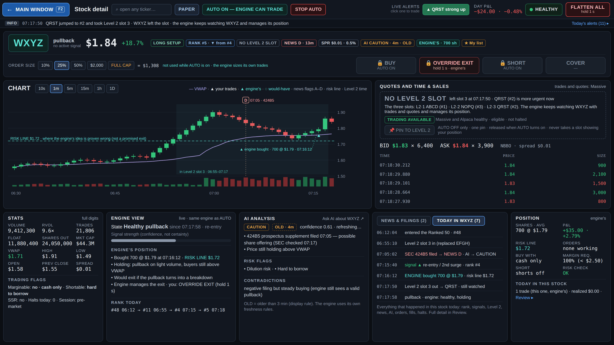

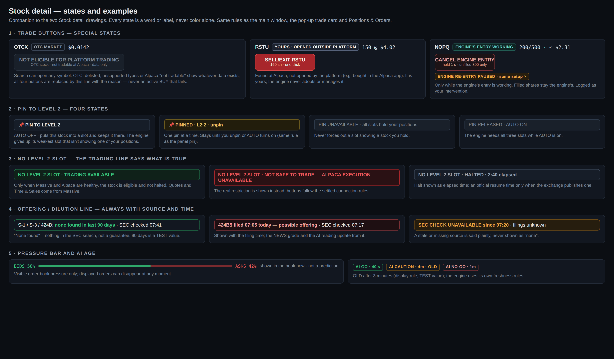

# 10. AI Assistant window

**Purpose:** ask questions about stocks, trades, alerts and the platform's own rules, with sources — read-only, context not prediction. Opens from "Ask AI" (top bar), Windows ▾, "Ask AI about XXXX" (Stock detail) and "Ask AI about this trade" (Review). Mockup AI1 (opened with "Ask AI about ABCD", PAPER, AUTO OFF, 07:43).

## 10.1 Layout

Thin top bar ("AI Assistant") + alert line. Three columns: **QUICK QUESTIONS** + **EARLIER QUESTIONS** (left) · **CONVERSATION** (middle) · **CONTEXT ATTACHED**, **WHAT IT CAN READ**, **WHAT IT CAN NEVER DO**, **AI SERVICE** (right).

## 10.2 Asking

- Context attached as a chip when opened from another window ("📎 ABCD · live snapshot 07:42:31", a Review trade, or an alert), removable with ×.
- **Historical context never looks live:** from Review the chip reads "HISTORICAL TRADE · MNOP · 07:25:03" (from a Replay moment: "HISTORICAL · REPLAY 07:12:52"); a ticker clicked from there opens the card headed "LIVE CARD · CURRENT MARKET".
- Quick questions: pre-market brief on the Ranked 50 · what changed in the last 5 minutes · why the engine took, skipped or exited a stock · explain today's trades (from Review) · compare two stocks · what a filing, halt or alert means · "Why is my button LIMITED or blocked?" (platform help).
- 🎤 microphone for questions only: it listens only while you hold or click it (visible "listening…"), types into the question box, and you review or edit and press Ask yourself. It never sends by itself and is never a voice-trading path.
- Earlier questions: kept for you only, searchable; never used by the engine.

## 10.3 Answers

- Shape: **SHORT ANSWER** first, then only the sections that are relevant — FROM THE DATA (facts) · THE NEWS AND FILINGS · MY READING · RISKS (interpretation, contradictions stated) — and source chips with times (engine log, Massive, IBKR, Newswire, SEC EDGAR, Alpaca, Review). "Context, not a prediction." A simple question gets a short answer, not an empty template.
- Source chips are links where practical: Newswire → News & Catalysts · SEC → the filing · Alpaca position / order → Positions & Orders · engine event → Review / Stock detail.
- If a source is stale or down, the answer says so. If sources disagree, the answer says **"SOURCE CONFLICT"** and shows both; it never quietly picks one.
- Every ticker in a question or answer is a link that opens the pop-up trade card (the buy is the second click, on the card).
- Asked to trade ("Buy 500 more ABCD"), it refuses: **"The AI Assistant cannot place, change or cancel orders. To trade manually, open the current trade card ▸"**, plus the size and limit facts (e.g. "Right now your size is 25% = $1,308, but a new BUY would be LIMITED by cash: $27.76 available").
- **Platform help** answers from the current approved, versioned platform rules plus the live Settings state (which set is active, PAPER or LIVE, and its values) — never from an old File 9. The answer names the rule and says when a value is a TEST value (e.g. "Hard limit $600 (LIVE set, TEST value)").

## 10.4 Locked limits (🔒, shown in "WHAT IT CAN NEVER DO")

Place, change or cancel orders · change settings or turn AUTO on / off · pin Level 2 or change the engine's verdicts · sit in the engine's path (own queue; questions never slow the engine or its AI checks).

## 10.5 What it can read (with freshness)

Engine states, ranks, signals, logs (live) · Level 2 slots (IBKR) and trades (Massive) (live) · news (Benzinga) · filings (SEC EDGAR) · FDA (openFDA) · your positions and orders (Alpaca) · Review (journal, replays, results) · Settings (read only) and the platform rules (this document). News reaches it as engine summaries (section 2.13); it can fetch a full headline or filing when needed.

## 10.6 Service

- AI SERVICE: status and typical answer time ("● ready · ~3 s per answer"); if down: **"AI ASSISTANT UNAVAILABLE — trading and the engine are not affected"**.
- "Used today: 18 questions · est. $0.21".
- Daily Assistant budget: when reached, **"AI ASSISTANT DEGRADED · DAILY BUDGET REACHED"**; trading continues normally.

## 10.7 Acceptance checks — AI Assistant

- **AI-01** No path from this window (text, voice, chips, links) can place, change or cancel an order, change a setting, or turn AUTO on / off.
- **AI-02** Every factual answer carries source chips with times; stale or conflicting sources are stated.
- **AI-03** Historical context chips and live cards are labeled as specified.
- **AI-04** The microphone only fills the text box and never sends by itself; it listens only while held or clicked.
- **AI-05** Questions never delay the engine or its AI checks (separate queue); the service-down and budget states leave trading unaffected.
- **AI-06** Platform-help answers match the active Settings set and name TEST values.

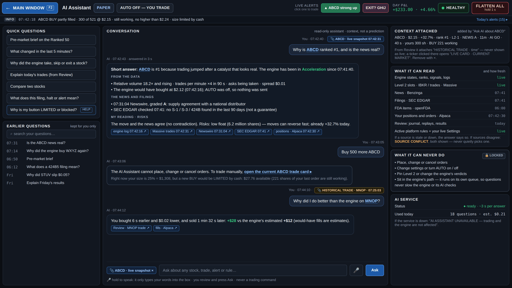

# 11. News & Catalysts window

**Purpose:** headlines and filings for the stocks that matter, graded A–D with the AI's one-line reason, plus a dilution and filing watch. Opens from Windows ▾ and from a headline click in Stock detail. Ticker click = pop-up trade card (the buy is the second click, on the card); double-click = Stock detail. Mockup NW1 (PAPER, AUTO OFF, 07:42, the ABCD 07:31 headline selected).

## 11.1 Which stocks it shows

- **Default view: news and filings ONLY for (1) the Ranked 50, (2) My list and (3) every stock with an open position (yours or the engine's, even when an engine-held stock has left the Top 50)** — button "Ranked 50 + My list + ALL OPEN POSITIONS". The Dilution and filing watch uses the same group.
- "Open positions" narrows to held stocks; "All market" and the ticker search widen to every stock the platform tracks (~8,000).
- **RELATED rows:** news about a stock outside these lists appears only when the engine has identified a clear relationship to a monitored stock, as one row marked "RELATED → CDEF, KLMN · same sector" so you see why it matters. Unrelated outside news never shows.
- Screen filters do not affect analysis: the engine monitors market-wide news for the eligible universe; the AI receives summarized context (section 2.13).

## 11.2 Layout

Thin top bar ("News & Catalysts") + alert line. Left: **HEADLINES AND FILINGS**. Right: **SELECTED** headline, and **DILUTION AND FILING WATCH**.

## 11.3 Headlines and filings

- Scope buttons (11.1) · ticker search · grade filters A · B · C · D · source filters News · SEC · FDA.
- Legend "A very good · B good · C not that good · D bad — bright under ~1 h, then dim" and the source freshness line "Benzinga live · SEC EDGAR checked 07:41 · openFDA 06:00"; a stale or down source is named, never hidden.
- Columns: **TIME** (published, to the second, with age "11m ago") · **STOCK** (with YOURS / ENGINE'S / RELATED chip) · **NEWS** (grade letter, bright / dim) · **SOURCE** (Newswire, SEC 424B5, SEC 8-K, FDA …) · **HEADLINE · AI's one-line reason** · **MOVE SINCE**.
- **MOVE SINCE** = price change measured from the first tradable price after the platform **received** the item (not the vendor's publish time), so there is no look-ahead. A fact, not a prediction. The same received time is what Review and the engine's research use.
- **One event, several reports:** when Benzinga reports an SEC filing also received from EDGAR (or several outlets carry the same story), they are grouped as ONE event with all sources and times — the original source (for a filing, the SEC / EDGAR item, normally also the first received) is marked PRIMARY, other reports are UPDATE sub-rows ("↳ same event · counted once"). The engine never counts them as independent catalysts. A later correction or addition shows as UPDATE.
- **SOURCE CONFLICT** only when sources truly disagree ("Newswire says two new states; the 8-K lists one") — both kept, never quietly one picked.
- Note under the list: filters change only what you see; TIME = published; MOVE SINCE starts at receipt; grouped events counted once.

## 11.4 Selected headline

- Grade + "very good news", the stock with its owner chip, the full headline; "published 07:31:04 · received 07:31:07.180 · Newswire (Benzinga)".
- **WHY THE AI GRADED IT A** (reasons, including the SEC dilution check with its time).
- **MARKET MOVEMENT SINCE HEADLINE — facts, not causation or prediction:** move from the first tradable price after receipt ("+22.2% from $1.76 (first tradable price after received 07:31:07) → $2.15"), volume since, rank move, engine state, Level 2 slot.
- **CONTRADICTIONS · OTHER NEWS ON THE STOCK.**
- The rule on screen: the grade is about the news only — it never blocks a trade by itself and is separate from the rank; bright for about 1 hour, then dim (display only).
- Buttons: **Open XXXX page** · **Read full text ↗** · **Ask AI about this headline ↗** (opens the AI Assistant with the headline attached).

## 11.5 Dilution and filing watch

- Offerings (S-1, 424B), shelves (S-3), reverse splits and delisting notices for the Ranked 50, My list and all open positions, newest first; look-back 90 days (TEST value, the same as Stock detail); "SEC checked 07:41"; if the SEC source is down: "SEC CHECK UNAVAILABLE since …".
- Each row: stock · filing + time · what it means in plain words · YOURS / ENGINE'S when held; held rows are tinted so none is missed.
- Halts stay in the alerts and on the stock (no separate halts list).

## 11.6 Acceptance checks — News & Catalysts

- **NW-01** The default view contains only the Ranked 50, My list, all open positions and RELATED rows; All market and search widen correctly.
- **NW-02** MOVE SINCE is computed from the first tradable price after the received time; both published and received times are shown for the selected item.
- **NW-03** Duplicate reports of one event are grouped (PRIMARY + UPDATE) and counted once by the engine.
- **NW-04** A stale or down source is named on the freshness line and in the filing watch, never shown as "none".
- **NW-05** Outside news appears only as RELATED rows with the named relationship.

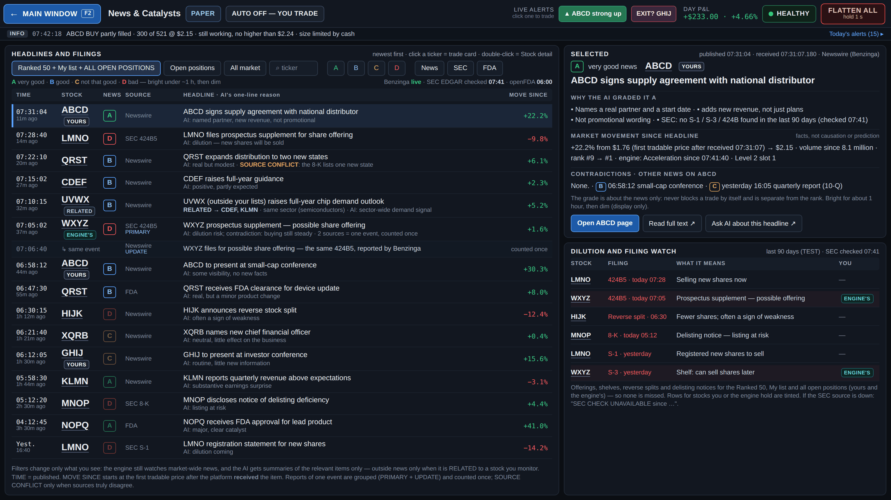

# 12. System Health window

**Purpose:** show in words what is healthy, what is not, what still works, and why — without cluttering the trading screen. Opens from the health word in any top bar (click; hover shows the three main connections) or Windows ▾. Mockups SH1 (normal day, PAPER, AUTO OFF, 07:42) and SH2 (every problem state).

## 12.1 Status band (top, full width)

- The health word + the reason + the check time: "● HEALTHY — everything is working · all checks passed 07:42:30".
- **WHAT WORKS NOW** chips: AUTO CAN START · YOUR BUY / SHORT · EXITS · STRATEGIES ("all available", or which strategies are off and why). Every state in words, never color alone.
- "↻ Run all checks now".

## 12.2 Start-up & safety checks (left column)

Runs from 4:00 a.m., before AUTO starts or LIVE is switched on, and all session. A failed check shows ✗ (must pass) or ! (should pass) with its reason, time and what it blocks.

- **MUST PASS — one failure blocks AUTO and going LIVE:** approved versions loaded · PAPER / LIVE clearly set (the right settings set loaded) · Alpaca connected, correct account, cash and buying power read · leverage 1× at Alpaca = platform, long-only (Phase 1) · positions and orders match Alpaca (IN SYNC) · no intraday margin call · market data (Massive) live, not stale · clock synchronized (drift shown) · market calendar and session correct · risk engine and loss limits loaded · journal and database writing · STOP AUTO and FLATTEN ALL path working.
- **SHOULD PASS — if not, DEGRADED, still safe to trade:** IBKR Level 2 logged in · news & filings sources fresh (Benzinga · SEC · FDA) · AI service ready.
- **Already LIVE:** a failed must-pass check never switches the account back to PAPER by itself. LIVE cannot be newly switched on; while already LIVE, new risk is blocked as that check's rule says; exits stay available whenever execution is possible.
- **THE THREE HEALTH WORDS** explained on screen (section 3.5).
- **STRATEGIES · WHAT EACH NEEDS** (example): long engine — Alpaca · Massive; Level 2 strategies — + IBKR Level 2; AI context check — + AI service; short engine — PAPER ONLY (Phase 3). Each strategy declares its sources (news, SEC, FDA too); a missing source turns off only the strategies that need it ("ON · UNAVAILABLE"), and the band names them.

## 12.3 Connections (middle)

| Connection | Detail | Status · last seen · delay | If it fails |
|---|---|---|---|
| ORDERS · ALPACA | masked account · orders, fills, cash | "connected · 0.3 s ago · 38 ms" | NOT SAFE TO TRADE · AUTO and new entries blocked · Critical |
| LEVEL 2 · IBKR | logged in · 3 of 3 slots | connected | DEGRADED · Level 2 strategies off · Attention |
| MARKET DATA · MASSIVE (trades) | whole market | connected | NOT SAFE TO TRADE · new entries blocked · exits work · Critical |
| MARKET DATA · MASSIVE (quotes) | whole market | connected | same |
| NEWS · BENZINGA | headlines | live | DEGRADED · strategies that need it off · NEWS UNKNOWN |
| FILINGS · SEC EDGAR | S-1, S-3, 424B, 8-K | checked 07:41 | DEGRADED · strategies that need it off · SEC CHECK UNAVAILABLE |
| FDA · openFDA | approvals, clearances | checked 06:00 | DEGRADED · strategies that need it off · FDA CHECK UNAVAILABLE |
| AI SERVICE | ~3 s per answer · est. $0.21 today | ready | DEGRADED · AI context check off · trading not affected |

- Under the Alpaca row, **checked 5 ways:** stream ✓ · API heartbeat ✓ · order endpoint ✓ · account endpoint ✓ · network ✓ · status page: operational (1 signal only). The three labels OUR ALPACA CONNECTION LOST / ALPACA OUTAGE / ALPACA CONNECTIVITY ISSUE · CAUSE UNKNOWN are decided from these signals; exact rules are set when the Alpaca connector is built and tested.
- Row states in words: "connected · 0.3 s ago" · "SLOW · 4.2 s delay" (delay above the limit, TEST; health unchanged until stale) · "RECONNECTING… attempt 2 · 3 s" (each attempt logged, gaps repaired after) · "NEEDS LOGIN since 07:44:10" · "STALE since 07:44:02" (treated like down for new entries) · "DOWN since 07:41:05". Never an "OK" without a time.

## 12.4 Speed, data quality and sources (middle)

- **SPEED OF EACH STEP** (sample values until measured): market event → our server (Massive) · Level 2 update (IBKR) → our server · update → engine signal · signal → risk and margin check · check → order sent · order → Alpaca confirms · Alpaca → first fill · total signal → fill.
- **DATA QUALITY:** stocks watched · ranked-list refresh · stale symbols · gaps repaired · halted now · orders rejected · alerts today · AI check age.
- **WHERE EACH NUMBER COMES FROM:** quotes and trades: Massive · Level 2 book: IBKR · orders, fills, positions, cash, buying power, borrow: Alpaca · news: Benzinga · filings: SEC EDGAR · FDA: openFDA; every event keeps provider, received and processed times.

## 12.5 Right column

- **ACCOUNT SAFETY · ALPACA:** "INTRADAY MARGIN CALLS: 0 — TARGET 0" · margin stage NORMAL (then HEADROOM LOW, then CALL) · leverage "1× at Alpaca = 1× in the platform ✓ match" · shorting "OFF at Alpaca (long-only) · Phase 1 of 4" · broker check "IN SYNC 07:42:30 · check now" · "CLOSED BY ALPACA: none today".
- **LEVEL 2 SLOTS · IBKR:** the three current slots (with owner chips) and today's slot changes with time, slot, change and why.
- **INCIDENTS TODAY:** reconnects and errors (e.g. "07:12:03 Massive reconnect (1.2 s) · resynced, no gaps left"); every incident is saved in the audit log and listed in Review's Day events (connection incidents counted in Performance).
- **SERVER & CONTROL PANELS:** CPU, memory, event backlog, disk; "This laptop ● connected · Phone ● last seen 07:40"; **"PHONE NOTIFICATIONS · OS PERMISSION ALLOWED (verified 07:40)"** — or "… OS PERMISSION BLOCKED", matching the phone's own banner. If the laptop goes offline nothing stops; the phone shows "Control panel offline · AUTO ON".

## 12.6 States (SH2) — the band shows what is wrong and what still works

| Band | What still works | Alert |
|---|---|---|
| DEGRADED — IBKR NEEDS LOGIN · LEVEL 2 PAUSED | AUTO can start without Level 2 strategies; your BUY/SHORT allowed; exits available; "STRATEGIES OFF: Level 2 strategies · need IBKR". Fix: log in to IBKR again — Level 2 and its strategies come back by themselves; panels show "LEVEL 2 UNAVAILABLE"; Settings shows "ON · UNAVAILABLE — IBKR L2 DOWN" | Attention |
| NOT SAFE TO TRADE — OUR ALPACA CONNECTION LOST ("ALPACA EXECUTION UNAVAILABLE · PLATFORM CANNOT RELIABLY CONTROL ORDERS") | AUTO blocked; your BUY/SHORT blocked; exits can't be sent from the platform; **"Manual backup: use Alpaca directly"** | Critical |
| NOT SAFE TO TRADE — ALPACA OUTAGE (broker side confirmed) | same, no manual-backup line; the platform keeps trying and runs a broker check when it is back | Critical |
| NOT SAFE TO TRADE — ALPACA CONNECTIVITY ISSUE · CAUSE UNKNOWN | AUTO blocked; BUY/SHORT blocked; exits uncertain — may not reach Alpaca | Critical |
| NOT SAFE TO TRADE — MASSIVE DATA STALE | no new entries; your BUY/SHORT refused while data is stale; exits available; positions still watched with remaining healthy data | Critical |
| NOT SAFE TO TRADE — INTRADAY MARGIN CALL · $412 · CURE REQUIRED (Alpaca deadline) | AUTO and BUY/SHORT blocked; exits available; "EST. SELL 200 ABCD TO CURE MARGIN" (your click only) | Critical |
| NOT SAFE TO TRADE — CLOCK OUT OF SYNC (drift vs limit, TEST) | AUTO and BUY/SHORT blocked; exits available | Critical |
| NOT SAFE TO TRADE · AUTO BLOCKED — BROKER SYNC (account level: cash, buying power, total positions or account state) | all new entries blocked; exits available; Alpaca's numbers win | Critical |
| DEGRADED · ABCD BLOCKED — BROKER SYNC (one stock) | AUTO continues except ABCD; your BUY/SHORT allowed except ABCD; exits available | Critical |
| DEGRADED — NEWS SOURCE DOWN · BENZINGA | AUTO can start; BUY/SHORT allowed; exits available; strategies that need Benzinga "ON · UNAVAILABLE"; NEWS UNKNOWN, never "no news"; extra size reduction is a testing question | Attention |
| DEGRADED — AI SERVICE UNAVAILABLE | trading and the engine not affected; AI context check "ON · UNAVAILABLE"; Ask AI "AI ASSISTANT UNAVAILABLE" | Attention |
| RECOVERING — CHECKING BEFORE AUTO CONTINUES | live checks: connection ✓ · positions & orders match Alpaca ✓ · UNKNOWN orders 0 ✓ · data gaps (only those affecting an active strategy, open position or pending order) · clock & risk ✓ → "AUTO CONTINUES" or "AUTO STAYS BLOCKED — press Resume AUTO" with the reason | Info |

AUTO BLOCKED — ORDER LIMIT (order circuit breaker tripped, chapter 16) is a Critical AUTO block shown in the AUTO state and the alert line (T1, state 5).

## 12.7 Recovery rules

- Health returns by itself when the checks pass again; after any broker problem a fresh broker check runs first (Alpaca's numbers win).
- AUTO continues by itself only after a **verified recovery**: connection / data genuinely healthy · positions and orders match Alpaca · no UNKNOWN order unresolved · no unresolved data gap that affects an active strategy, open position or pending order · clock and risk state valid. If anything is uncertain, AUTO stays blocked until you press Resume AUTO (hold 2 s, main window).
- Repeated drops (for example 3 in 15 minutes, TEST) keep AUTO blocked until you resume.
- **Never auto-resume, however short:** intraday margin call · hard daily limit · FLATTEN ALL · your STOP AUTO · an unresolved broker mismatch · the soft-limit and give-back pauses.
- Your positions are never sold because of a disconnect. What the engine does with its own positions during a long outage is decided in reliability testing (OPEN).

## 12.8 Acceptance checks — System Health

- **SH-01** Each must-pass check, when failed in a test, blocks AUTO and going LIVE and shows its reason and time; each should-pass failure makes Health DEGRADED only.
- **SH-02** For every row in 12.6, simulating the failure produces exactly that band, those "what works" chips and that alert level.
- **SH-03** The three Alpaca labels are chosen from the five signals; the status page alone never marks Alpaca healthy; "Manual backup" appears only with OUR ALPACA CONNECTION LOST.
- **SH-04** Recovery: after a short blip with all checks passing AUTO continues; with an UNKNOWN order or a relevant gap it stays blocked with the reason; the never-auto-resume list holds.
- **SH-05** Every connection row shows a time; no "OK" without a time.
- **SH-06** A failure never changes a setting.

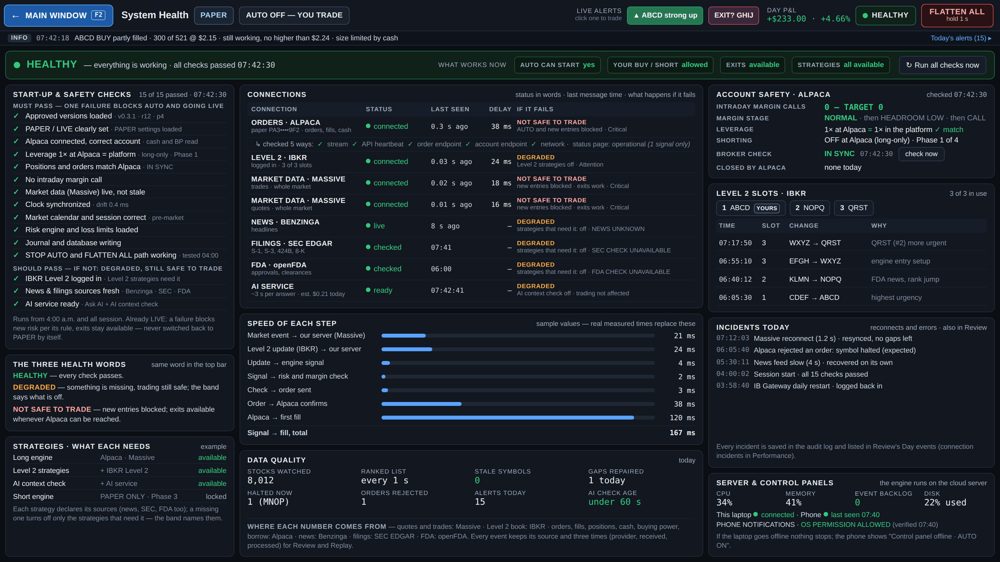

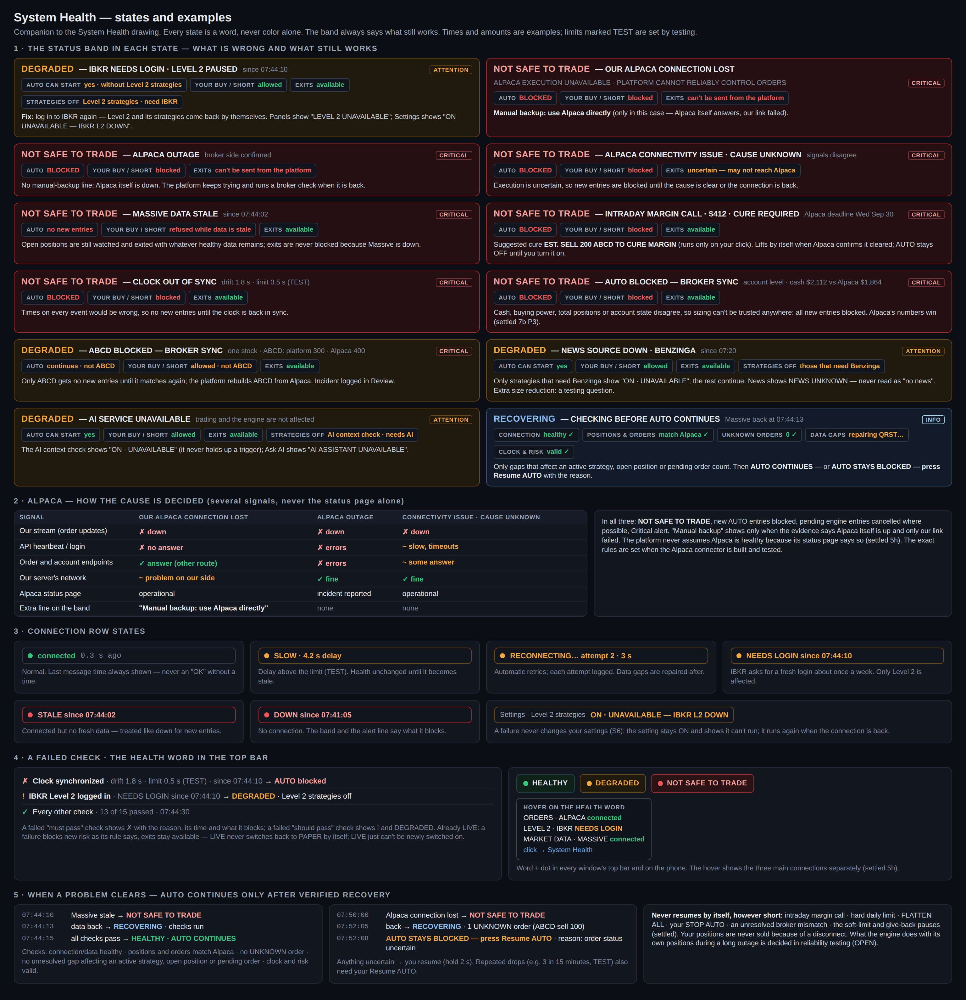

# 13. Phone view

**Purpose:** watch and stop the platform from anywhere when the laptop is closed. The engine runs on the cloud server, so trading continues without the laptop; the phone shows the state and can stop it — it never buys. Mockup PH1 (four screens + the outside-watchdog notification). How the phone page is built (a web page on the home screen or an app) is a build decision.

## 13.1 What it shows

- **PAPER / LIVE — REAL MONEY** (red frame in LIVE) — **display only**: the phone can never switch the account between PAPER and LIVE.
- AUTO state in words; the health word; session and clock; "Control panel offline · AUTO ON — laptop closed at 07:30; the engine keeps trading on the server" when true.
- DAY P&L, EQUITY, the loss meter.
- The Critical banner (stays until the problem is resolved; **SEEN** stops the repeating sound); latest alerts and today's full list.
- Open positions (all of them, with "scroll" when more than fit): owner chip (YOURS / ENGINE'S), shares @ average, now, P&L, flags (HALTED, EXIT?, STOP, order working). Tap = read-only details (price, P&L, small chart, stop, status).

## 13.2 What it can do

- **STOP AUTO** — hold 1 s (against pocket taps). Shown disabled "AUTO is off" when AUTO is off.
- **FLATTEN ALL** — hold 1 s, everything (yours and the engine's).
- **SELL/EXIT your own positions** — hold 1 s, with the same protected exit logic as the desk. At the exit boundary "EXIT NOT FILLED · bid below $7.52 · 172 sh left" and **"SELL LOWER TO $7.48"**, which also needs the 1 s hold (a filling bar; releasing early does nothing). After the hold: WORKING → FILLED, alert and sound on the phone and the desk.
- Engine positions: "🔒 engine's · FLATTEN ALL only".
- Every phone action is logged "from phone".

## 13.3 What it never does

Buy or short · turn AUTO on or Resume AUTO · switch PAPER ↔ LIVE · change settings · OVERRIDE EXIT · CANCEL ENGINE ENTRY.

## 13.4 When exits lock

Exits are enabled only when the phone has fresh Alpaca / account state and execution is healthy. They lock, with the reason on the button, when:

- the phone is offline or stale — banner **"PHONE OFFLINE · last update 07:40 — numbers may be old · exits locked until the phone reconnects"**; AUTO and health show "as of 07:40" in grey, so old numbers never look live;
- execution is not healthy — "exits locked · execution uncertain" (e.g. ALPACA CONNECTIVITY ISSUE · CAUSE UNKNOWN);
- that stock has an UNKNOWN order — "exit locked · order UNKNOWN, checking".
- A halted stock shows "COVER PENDING · sends when trading resumes" / "HALTED · exit pending", as on the desk.
- Exits unlock by themselves when the phone has fresh Alpaca data and execution is healthy.

## 13.5 Notifications

- **Critical:** always sent; cannot be turned off inside the platform while LIVE. **Attention:** your choice (Settings). **Info:** never.
- The platform cannot override the phone's own notification settings. If notifications are blocked there, the phone view shows **"NOTIFICATIONS OFF IN PHONE SETTINGS — you won't get Critical alerts. Turn them on in the phone's settings."** and System Health shows "PHONE NOTIFICATIONS · OS PERMISSION BLOCKED".
- Tapping a notification opens the phone view at that item.
- **Outside watchdog:** if the trading server stops sending its heartbeat, a separate service outside the server's failure domain sends **"SERVER UNREACHABLE · No heartbeat from the trading server since 10:31:05. The platform can't be reached — if you must act, use Alpaca directly."** The watchdog has notification authority only, no trading keys (chapter 16).

## 13.6 Security

Sign-in with a PIN or Face ID. The phone never holds broker keys; it talks only to our server (chapter 16).

## 13.7 Acceptance checks — Phone

- **PH-01** No control on the phone can buy, short, turn AUTO on, resume AUTO, switch PAPER / LIVE, change a setting, OVERRIDE EXIT or CANCEL ENGINE ENTRY.
- **PH-02** STOP AUTO, FLATTEN ALL, SELL/EXIT and SELL LOWER need a 1 s hold; releasing early does nothing.
- **PH-03** With the phone offline, a stale state, unhealthy execution, or an UNKNOWN order on that stock, exits lock and say why; old values are labeled "as of".
- **PH-04** Critical notifications arrive for every Critical event while LIVE; a blocked OS permission is shown on the phone and in System Health.
- **PH-05** Stopping the trading server produces SERVER UNREACHABLE from the outside watchdog.
- **PH-06** Every phone action appears in the audit log as "from phone".

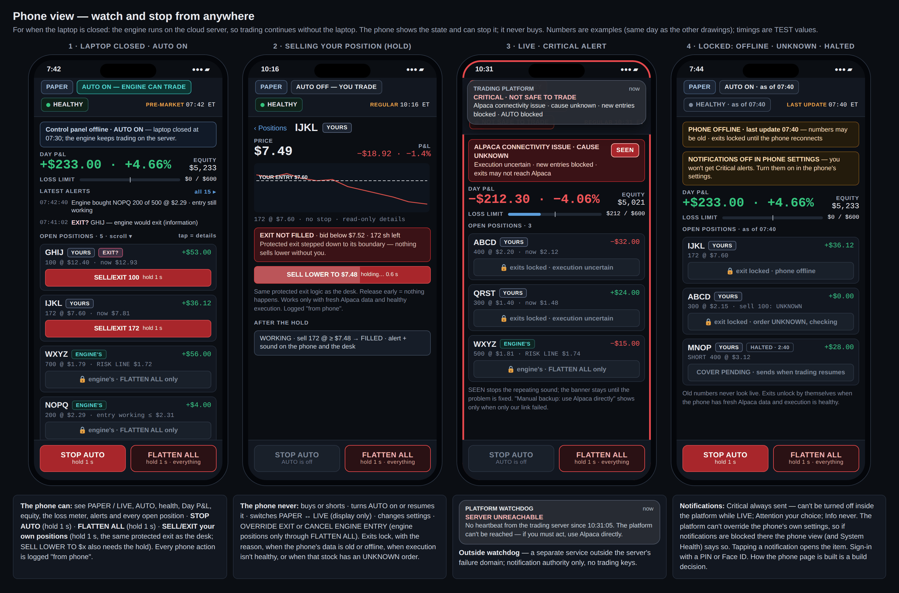

# 14. Reference pages

Three one-page references that consolidate rules used everywhere. They replace v3 §7, v3 §8 and v3 Figure 9. Mockups REF1–REF3.

## 14.1 Who owns a position (REF1)

**Rule:** whoever opened a position owns it. Switching AUTO on or off never hands a position from one owner to the other.

| Label | Meaning | Who can close it |
|---|---|---|
| YOURS | You opened it with BUY or SHORT (AUTO off). No automatic exit; EXIT? is information only; optional + STOP after entry. | You — SELL/EXIT or COVER, one click, also while AUTO is on (phone: hold 1 s); also your stop, FLATTEN ALL, or a forced liquidation by the broker or exchange. The engine never trades it. |
| ENGINE'S | The engine opened it in AUTO ON; shows its RISK LINE. Switching AUTO off never makes it sell; it keeps managing it and opens nothing new. | The engine. You: OVERRIDE EXIT (hold 1 s, desk only) for that one position, or FLATTEN ALL. |
| WOULD-HAVE (dashed teal) | A trade the engine would have taken while AUTO was off. No money, no orders. | Nobody — it exists only in Review. |
| YOURS · OPENED OUTSIDE PLATFORM | Found at Alpaca but not opened by the platform (e.g. bought in the Alpaca app). | You, like any of yours. The engine never adopts or manages it. |

**Controls:** STOP AUTO · CANCEL ALL ENTRIES · CANCEL ENGINE ENTRY · OVERRIDE EXIT · FLATTEN ALL · + STOP — as in section 4.7 and the gestures table (3.6).

**Safety rules:** hard controls may block new risk but never close your positions on their own. Soft loss limit / give-back — AUTO pauses, your trading stays allowed. Hard loss limit — all new entries blocked, yours too; exits always allowed; no resume that day. Intraday margin call — AUTO and your BUY/SHORT blocked; exits available; the engine sells only what it needs of its own; a cure button for yours that runs only on your click. Disconnects never sell your positions. A forced sale by Alpaca shows "CLOSED BY ALPACA · MARGIN".

**Example day**

1. 10:00 — AUTO is on. The engine holds WXYZ (ENGINE'S) and has an entry working in NOPQ.
2. 10:01 — You press STOP AUTO. The unfilled part of the NOPQ entry is cancelled (filled shares stay the engine's). The engine keeps managing WXYZ; its exit is locked for you. Nothing new opens.
3. 10:05 — You buy GHIJ and IJKL (YOURS). Their buttons work; the engine never trades them.
4. 10:12 — You hold OVERRIDE EXIT on WXYZ for 1 s. Only WXYZ closes; logged as your intervention; the engine won't re-enter WXYZ on the same setup.
5. 10:30 — You turn AUTO back on (main window, hold 2 s). The engine may open new trades. GHIJ and IJKL stay yours; their SELL/EXIT still work.
6. 10:45 — Away from the desk, you sell IJKL from the phone (hold 1 s, same protected exit).
7. Any time — emergency: hold FLATTEN ALL 1 s; everything closes; AUTO stays off until you turn it on.

## 14.2 Signals, colors, sounds and alerts (REF2)

Consolidates chapter 3: one job per color (3.2), the blink rule and markers (3.3), alert levels, the alert line and sounds (3.4), the health words (3.5). Includes AUTO BLOCKED — ORDER LIMIT in the Critical list and NEWS UNKNOWN in the markers.

## 14.3 Windows map (REF3)

The main window never closes and holds only what you need to act in seconds; anything you read gets its own window, one click away in Windows ▾ (7 windows). Every separate window has the thin top bar and the alert line. The map lists each window with how it opens, its key contents, its settled section and its mockup IDs, plus the pop-up trade card, the thin top bar, the phone view and these reference pages. It is a planning map, not a window of the platform.

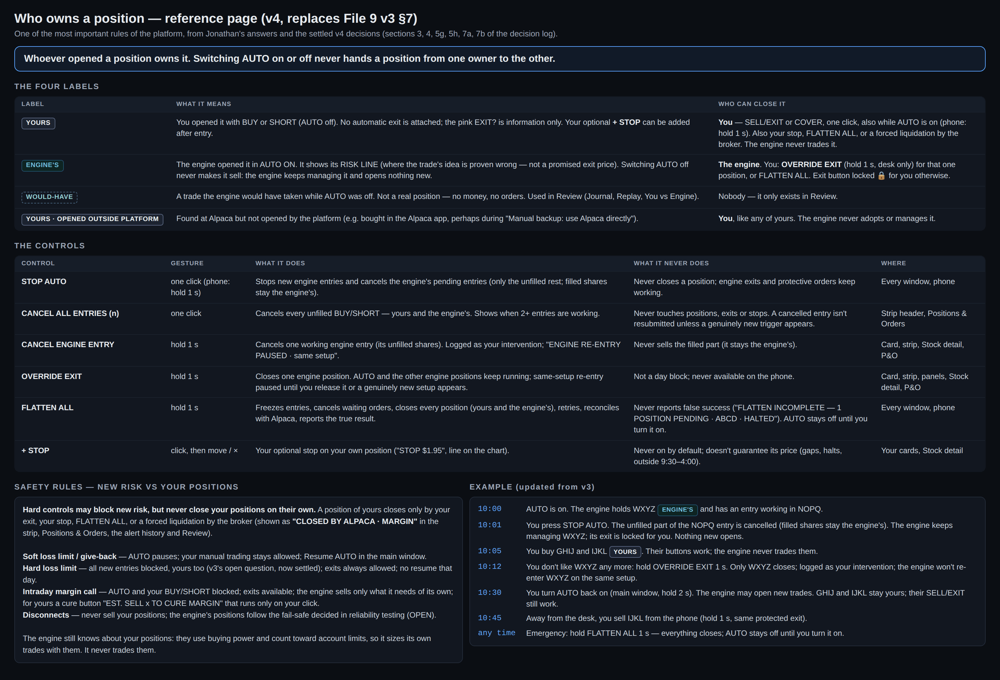

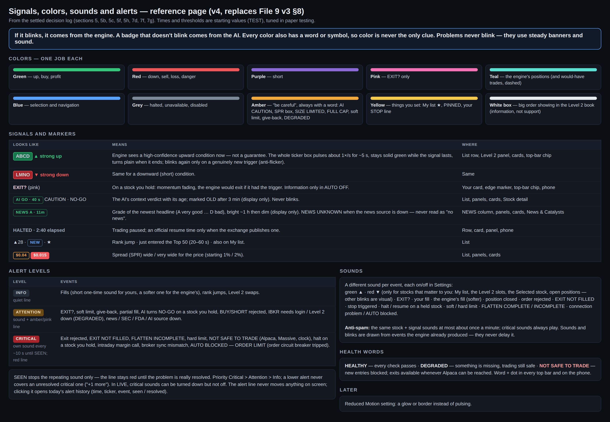

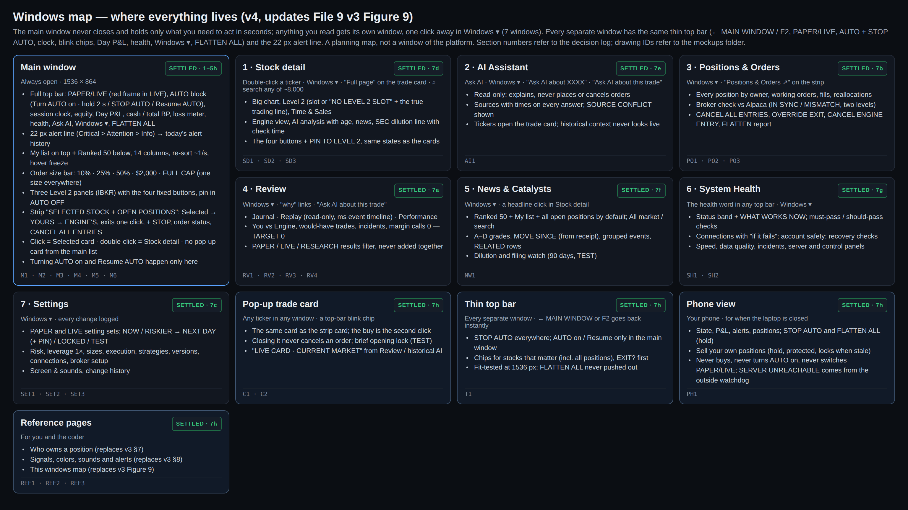

# 15. Phase 0 — research and validation architecture

**Status: SETTLED.** Phase 0 comes first. It decides — with real historical market data and realistic trading friction — whether the designed opportunity classes, ranking logic, entries, exits, re-entries, risk rules and supporting features produce a repeatable advantage, before months are spent building everything around assumptions. It is not the final training cycle and not live trading.

## 15.1 Questions Phase 0 must answer

- Can the engine detect the designed move types — explosive runners, moderate moves, rebounds, slow sustained trends, post-spike secondary moves (shorts later) — early enough to be useful, not after most of the move is gone?
- Does the Ranked 50 / candidate ranking surface the best opportunities from the broad universe?
- Which signals and features matter, and which are noise?
- Does early-deterioration exit + structural backstop + stricter re-entry beat simply holding through pullbacks once spread, slippage, commissions, missed fills and whipsaws are included?
- Can the system avoid deep reversals it must never ride (for example $3 → $1.50)?
- How does it behave across regimes: hot momentum days, quiet days, selloffs, low-volume periods, different volatility?
- How much do slippage, spread and liquidity reduce the apparent edge? What sizes are realistically tradable?
- Is historical Level 2 needed for some strategies, and how much? Is Massive data alone enough for some strategy classes?
- Is a larger historical research / training cycle justified? What must change before paper trading?

## 15.2 Verdicts

One verdict for each major strategy component and for the platform concept as a whole: **GO · GO WITH CHANGES · NO-GO · NOT ENOUGH EVIDENCE**. NOT ENOUGH EVIDENCE is used when a class appears too rarely in the sample to judge; it is different from NO-GO.

## 15.3 How it is built

- The **same core engine / scanner / ranking / strategy code** intended for live trading, connected to a **research adapter** instead of Alpaca:

  Massive historical data → event-by-event replay → engine / scanner / ranking / strategy logic → simulated execution → Review / Performance analysis

- It runs in the separate Research environment (no LIVE credentials there — chapter 16).
- Phase 0 is not a UI project. Review / Performance can show results, but the priority is the research engine. Alpaca, real-money controls and finished production features are not needed for Phase 0.
- **The simulated broker models:** bid / ask spread, protected entry ceilings, slippage, liquidity, partial fills where reasonably modelable, fees, halts (including LULD reopen gaps), session rules, order delays, failed or missed entries, exits and re-entries. Never a backtest where every order fills at the wanted price.

## 15.4 Research rules — Jonathan's four training rules + walk-forward

1. **No look-ahead:** at every historical moment the engine uses only what was available then. No future high, future headline, later rank or later volume may leak backward — also not into features, normalization, labels, candidate selection or thresholds.
2. **Locked final "secret exam":** a recent period is kept untouched and used once, at the very end.
3. **Realistic trading costs / friction** (15.3).
4. **No survivorship bias:** the history includes delisted, bankrupt and collapsed stocks and corporate actions (splits, reverse splits, symbol changes).
5. **Walk-forward testing** is a core requirement: tune on the past → test on the next unseen period → move forward → repeat.

## 15.5 Guarding against fooling ourselves

- **GO rules are written down before the tests run:** minimum trade count, results after costs, worst drawdown, stability across regimes — so the goalposts cannot move after seeing numbers.
- **The sample is chosen by rules decided in advance,** not by eye: quiet days, fake breakouts and failures, not only famous runners. Start with a representative sample across regimes, not all 23–26 years; expand only if results justify it.
- **Baselines:** compare against simple rules (a plain momentum rule; random entries with the same exits). The full engine must beat them after costs.
- **Side-by-side variants** (for example A structural hold · B early-deterioration exit + re-entry · C without Level 2 · D with Level 2). The number of variants is limited and every variant tried is recorded (many variants make a lucky false winner likely).
- **Ranked 50 detection measure:** for each big mover in the sample, when it entered the Ranked 50 and the top 3, and how much of the move was still left.

## 15.6 The AI in Phase 0

- Phase 0 establishes the engine's edge **without the LLM first**. The AI is then tested as a separate, additive component and must earn its place by improving unseen results after costs.
- Historical AI tests are trusted only when the model provably could not know the future — for example a model whose knowledge cutoff is before the test period. Hiding tickers or dates may be tried as an experiment but is not proof.
- When the AI model is upgraded its cutoff moves, so its test window moves forward and it is re-validated before it influences trading again.

## 15.7 Data, budget and outputs

- **Historical Level 2:** buy a small representative sample first — about 200 stock-days (TEST / budget value) — and more only if learning curves and out-of-sample results show it helps. Needed for the with / without Level 2 comparison; Massive does not supply historical Level 2.
- **Reproducible runs:** every run records its data snapshot, code version, parameters and settings. Results appear in Review labeled **RESEARCH**, never mixed with PAPER or LIVE.
- **Phase 0 sets the initial TEST values for trading / model parameters:** ranking thresholds, entry requirements, deterioration thresholds, structural stops / risk lines, re-entry requirements, slippage ceilings, liquidity / capacity limits, strategy parameters. User-interface timings (blinks, sounds, NEW tag, re-sort speed) are tuned in usability and paper testing, not here.
- **Budget and time limit** (data purchases and computing) are set before Phase 0 starts.
- **After Phase 0:** paper trading, then small live — the gates from Files 5, 7 and 8, as carried into Engine_v4_Current_Requirements, stay as written.

## 15.8 Acceptance checks — Phase 0

- **P0-01** A leakage test proves no feature, label, normalization, candidate selection or threshold uses information after its timestamp.
- **P0-02** The historical universe includes delisted and collapsed names and applies corporate actions point-in-time.
- **P0-03** The locked final period is untouched until the final run; the log proves it was used once.
- **P0-04** Every result is reproducible from its recorded snapshot, code version and parameters.
- **P0-05** The simulated broker never fills beyond the modeled spread, ceiling and liquidity; missed and partial fills occur.
- **P0-06** GO rules, sample rules and the variant list were recorded before the results; the final report gives one of the four verdicts per component and for the concept.

# 16. Security, resilience and platform protection

**Status: SETTLED.** Designed in from the start, not added later. Exact vendors, cloud topology, firewall rules, backup frequency, failover design and penetration-testing tools are chosen during construction, but the architecture must support every requirement here from day one.

## 16.1 What it protects

The account and money · broker and data credentials · trading logic and source code · market data and logs · server infrastructure · the integrity of orders, positions and risk controls. Security stays off the low-latency trading path wherever possible so it does not slow scanning, signals or execution.

## 16.2 Threats it must handle

Hackers and unauthorized access · stolen API keys · a compromised laptop or phone · cloud, server or data-center failure · network outages · Alpaca, IBKR or Massive outages · stale, corrupted or conflicting data · duplicate orders after reconnects · UNKNOWN order states · software bugs or runaway trading loops · risk-engine failure · broker / platform position mismatches · database corruption or data loss · bad deployments or updates · clock failures · overload, latency spikes, queue backlog · malicious or untrusted news, filings or text reaching the AI · accidental LIVE-setting changes · halts, flash crashes, inability to exit.

## 16.3 Required from day one

1. **Access and secrets:** MFA and least-privilege access; secrets in a secure store, never hard-coded, never in logs; execution credentials never in the UI, browser or phone (they talk only to our server); keys masked in Settings.
2. **Encryption** in transit and at rest; restricted server and network access; firewall rules.
3. **Separate Research, Paper and LIVE environments** with separate keys. The coder (Codex) and any AI coding tool never receive LIVE credentials: development uses paper keys only; LIVE keys exist only on the LIVE server; the code repository is scanned for secrets.
4. **No withdrawal permission** on trading API keys.
5. **Tamper-evident, append-only audit logs** (checksum chain) for orders, fills, settings and overrides.
6. **Unique / idempotent order IDs;** UNKNOWN orders never resent until Alpaca confirms.
7. **Independent order circuit breakers outside the strategy logic** (a strategy bug cannot bypass them): maximum orders per time window · maximum notional per order · maximum aggregate new exposure · duplicate-order protection · price sanity bounds on every limit order · abnormal order-rate detection. Tripped → **"AUTO BLOCKED — ORDER LIMIT"** (Critical). Limits are TEST values.
8. **Independent risk / kill controls;** fail-safe rule: if account or order state is uncertain, block new risk.
9. **Entry orders always expire** (never good-till-cancelled).
10. **Continuous Alpaca reconciliation** (broker check, two levels).
11. **Encrypted, off-site backups** with scheduled, tested restores; recovery targets start as TEST values.
12. **Server monitoring:** CPU, memory, disk, latency, health, queue backlog (System Health).
13. **Versioned deployments with rollback;** no normal deployments during the trading session (4:00 a.m.–8:00 p.m. ET) except emergency fixes; only approved versions go live (Settings → Versions / PROMOTE).
14. **Security updates, pinned dependencies and vulnerability checks.**
15. **Untrusted text:** external news, filings and web text are data, never instructions; the LLM is outside the execution path, has no order or settings authority, and its output is checked before use.
16. **Clock** synchronized from several sources; drift beyond the limit = NOT SAFE TO TRADE.

## 16.4 Outside watchdog

A small independent service outside the trading server's failure domain (a different machine or provider) checks the server's heartbeat and sends **"SERVER UNREACHABLE"** to the phone when it stops. It has notification authority only — no trading keys.

## 16.5 Second emergency route and account security

- Jonathan knows how to cancel everything, close positions and suspend trading **directly at Alpaca**, independent of our server (matches "Manual backup: use Alpaca directly").
- **Account protection** (the most likely theft route for one person is account takeover): MFA on Alpaca and on the email account (the recovery path) · a carrier PIN / SIM-swap protection on the phone number · a password manager · alerts on bank-link and withdrawal changes.

## 16.6 AI budgets

- **Assistant AI** (chat / Q&A): a daily budget; when reached → "AI ASSISTANT DEGRADED · DAILY BUDGET REACHED"; trading continues normally.
- **Trading AI / context** (only if validated into the decision system): separately provisioned and monitored, with an early warning well before its limit and a predefined fallback tested before LIVE — the engine-alone mode validated in Phase 0 — shown as "AI context check: ON · UNAVAILABLE". No cost cap may silently change the live strategy mid-day.

## 16.7 Resilience and recovery

- Define what happens if the primary server or data center fails; preserve positions, order state and logs.
- Every restart or recovery: rebuild from Alpaca, resolve UNKNOWN orders, check clock and data, show RECOVERING; AUTO stays blocked until reconciled (verified-recovery rules, section 12.7); never blindly resend orders.
- **Failure drills in PAPER before LIVE:** cut the network, kill processes, restart with open orders — confirm the recovery checks and duplicate-order protection work.
- Standby / failover infrastructure later, if account size justifies it.

## 16.8 On screen

System Health shows only the important states (HEALTHY / DEGRADED / NOT SAFE TO TRADE, provider outages, broker sync, stale data, server issues, recovery); security never clutters the trading screen. New visible states from this chapter: "AUTO BLOCKED — ORDER LIMIT", "SERVER UNREACHABLE" (phone, from the watchdog), "AI ASSISTANT DEGRADED · DAILY BUDGET REACHED".

## 16.9 Acceptance checks — Security and resilience

- **SEC-01** No secret appears in code, logs, the UI, the browser or the phone; the repository secret scan passes.
- **SEC-02** Development and Research environments hold no LIVE credentials; trading keys cannot withdraw.
- **SEC-03** Each circuit breaker trips in a test and produces "AUTO BLOCKED — ORDER LIMIT"; the strategy code cannot bypass it.
- **SEC-04** Reconnect tests never produce a duplicate order; UNKNOWN orders are never resent before Alpaca confirms.
- **SEC-05** Editing any audit-log entry is detected by the checksum chain.
- **SEC-06** A restore from backup succeeds in the scheduled drill.
- **SEC-07** Stopping the server produces SERVER UNREACHABLE from the outside watchdog.
- **SEC-08** A deployment attempted during the trading session is refused unless marked as an emergency fix; rollback restores the previous version.
- **SEC-09** Failure drills (network cut, process kill, restart with open orders) end in RECOVERING → verified recovery with no duplicate orders and correct positions.

# 17. OPEN items and TEST values

Build every item below as configuration or a replaceable module so it can be decided or tuned without a redesign.

## 17.1 TEST values (behavior settled, number tuned later)

| Area | Value | Starting value | Tuned by |
|---|---|---|---|
| Loss limits | Soft / hard daily loss (count closed + open) | drawings: soft $300 · hard $600 | Paper testing |
| Loss limits | Give-back amount from today's high | drawings: $500 | Paper testing |
| Loss limits | Recovery buffer before a new soft-limit pause | e.g. back above about −$250 with soft −$300 | Paper testing |
| Order size | Presets | 10% · 25% · 50% of equity · $2,000 | Paper testing |
| Caps | Most in one stock, most open positions, engine 1R, engine reserve, liquidity cap | examples in Settings | Phase 0 / paper |
| Execution | Entry ceiling rules and personal maximum slippage; stepping speed | dynamic %, adapts to spread / volatility / liquidity | Paper testing |
| Execution | Exit boundary for normal exits; FLATTEN emergency band; repricing speed | wider than entry; much wider for FLATTEN | Paper / replay |
| Execution | Halt-reopen order during FLATTEN | limit about 5% below the price, lower one step if not filled in about 2 s, stop at a maximum and alert | Paper / replay |
| Margin | Safety reserve left unused | set in paper and small LIVE tests | Testing |
| Reconciliation | Broker-check interval | every few seconds | Testing |
| Engine | Reallocation reserve size | — | Testing |
| Signals | Blink length; pulse rate; anti-flicker window; "clearly strengthens" level | about 5 s; about 1 per second | Paper testing |
| Signals | Green / red blink thresholds | from the engine | Phase 0 / paper |
| Display | AI verdict marked OLD after | 3 min | Usability |
| Display | NEWS letter bright for | about 1 hour | Usability |
| Display | List re-sort speed | about once a second | Usability |
| Display | NEW tag duration | 20–60 s | Usability |
| Warnings | Spread boxes (amber / red) — separate PAPER and LIVE values | 1% / 2% of price | Usability |
| Display | Closed card stays | about 5 s | Usability |
| Display | Blink chips in the thin bar | newest 3, then "+N more" | Usability |
| Locks | Panel button lock after a Level 2 swap | 0.5–1 s | Usability |
| Locks | Trade-card opening lock | about 0.5 s | Usability |
| Gestures | FLATTEN ALL hold · SELL LOWER past the band | about 0.75–1 s · 0.5 s | Usability |
| Alerts | Critical repeat interval · same-signal sound anti-spam | about 10 s · about 1 minute | Usability |
| My list | Maximum size · rows visible before scrolling | about 10–20 (drawn "5 of 20") · about 6 | Speed tests |
| Level 2 | Minimum time a stock keeps its slot (anti-thrashing) | — | Testing |
| News | Dilution / filing look-back | 90 days | Testing |
| Health | Clock drift limit | drawn example 0.5 s | Testing |
| Health | Connection "SLOW" delay limit | — | Testing |
| Recovery | Repeated drops that force a manual resume | e.g. 3 in 15 minutes | Testing |
| Security | Order circuit breakers (orders per window, notional per order, aggregate exposure, price bounds) | drawn example: 8 orders per 10 s | Testing |
| Security | Backup and recovery targets | — | Construction |
| AI | Assistant daily budget; trading-AI budget and early warning | — | Testing |
| Phase 0 | Historical Level 2 sample | about 200 stock-days | Budget / results |

## 17.2 OPEN items (not decided yet)

- What the engine does with its own positions during a long disconnect (fail-safe policy) — reliability testing.
- Where your optional STOP is held (Alpaca, our server, or both); stops outside 9:30–4:00 generally need a stop-limit (may not fill in a fast drop; halted stocks can reopen below the stop) — stop / execution design and paper testing.
- How the engine picks which of its positions to sell to cure a margin call.
- Whether and when to move to 1.5× and later 2× — only after clean real-money testing. The steps themselves are settled (1× → 1.5× → 2×, section 2.7); only the timing is open.
- The missed-runner rule and thresholds (versioned).
- Raw tick and Level 2 retention (how far back Replay can go); export formats beyond CSV.
- Whether extra size reduction helps while news is unknown (strategy-dependent rule is settled).
- Extra Level 2 slots if three prove too few.
- The sound design for each alert.
- The actual screen scaling on Jonathan's laptop (confirm 1536 × 864).
- Phone page technology (web page on the home screen or an app).
- Vendors, cloud topology, firewall implementation, backup frequency, failover design, penetration-testing tools.
- Standby / failover infrastructure (later, if account size justifies it).
- Partial exits (SELL HALF) — maybe later, after paper trading.
- The IBKR-only review (around $60,000, or earlier if IBKR adopts the new FINRA rules for the account).

## 17.3 Checks to do before or during LIVE rollout

- Verify at Alpaca that non-marginable penny stocks can be bought with own cash inside the margin account (Phase 2).
- Confirm same-day reuse of sale money at 1× (Phase 2).
- Verify IBKR market-data terms for personal internal use.
- Small real-money validation (penny stocks, cash-only, fills) before serious LIVE trading.
- Failure drills in PAPER (chapter 16).

# 18. Acceptance checks (summary)

A build is done when every check below passes in PAPER; LIVE additionally requires the rollout checks in 17.3. The detailed pass conditions are at the end of each chapter.

| Area | Checks |
|---|---|
| Main window (ch. 4) | MW-01 mode invariance · MW-02 one click · MW-03 order size · MW-04 ownership · MW-05 every position reachable · MW-06 no wrong-stock clicks · MW-07 signals · MW-08 My list · MW-09 NEWS letters · MW-10 top bar fit · MW-11 alert line · MW-12 emergency controls · MW-13 laptop fit · MW-14 no adding |
| Thin bar and trade card (ch. 5) | TB-01 … TB-04 · TC-01 … TC-05 |
| Review (ch. 6) | RV-01 … RV-07 |
| Positions & Orders (ch. 7) | PO-01 … PO-07 |
| Settings (ch. 8) | SET-01 … SET-08 |
| Stock detail (ch. 9) | SD-01 … SD-06 |
| AI Assistant (ch. 10) | AI-01 … AI-06 |
| News & Catalysts (ch. 11) | NW-01 … NW-05 |
| System Health (ch. 12) | SH-01 … SH-06 |
| Phone (ch. 13) | PH-01 … PH-06 |
| Phase 0 (ch. 15) | P0-01 … P0-06 |
| Security and resilience (ch. 16) | SEC-01 … SEC-09 |

**Platform-wide checks**

- **G-01 Windows:** every separate window opens from Windows ▾ (and its listed shortcuts), keeps the thin top bar and alert line, and closing any window stops nothing.
- **G-02 Consistency:** for every stock state in C2, the strip card, the Level 2 panel buttons, Stock detail and the trade card show the same wording and behave identically.
- **G-03 Screen never slows the engine:** with every window open, the engine's timing (event → signal → order) is unchanged within measurement noise.
- **G-04 Logging:** every human action and settings change appears in the audit log and in Review with time and source (desk or phone).
- **G-05 Wording:** every exact phrase in quotes in this document appears on screen exactly as written.
- **G-06 No hotkeys:** no keyboard shortcut sends or cancels an order or closes a position; F2 returns to the main window and Esc closes the pop-up trade card.

# 19. Appendices

## Appendix A — Mockup index

All mockups are in the folder `mockups/` as PNG files at 2× resolution (3072 px wide) of the 1536 × 864 design. They are the latest approved v4 design only.

| ID | File | Shows | Chapter |
|---|---|---|---|
| M1 | M1_Main_window_AUTO_OFF.png | Main window, AUTO OFF | 4 |
| M2 | M2_Main_window_AUTO_ON.png | Main window, AUTO ON | 4 |
| M3 | M3_Main_window_Windows_menu.png | Windows ▾ menu open | 4 |
| M4 | M4_Main_window_states.png | Alert line, AUTO / limits / health, FLATTEN sequence, card states, blinks, colors | 4 |
| M5 | M5_Main_window_worst_case_LIVE.png | Worst case in LIVE | 4 |
| M6 | M6_Main_top_bar_fit_test.png | Main top bar fit test | 4 |
| T1 | T1_Thin_top_bar_every_window.png | Thin top bar, six states | 5 |
| C1 | C1_Trade_card_in_News.png | Pop-up trade card in a window | 5 |
| C2 | C2_Trade_card_states.png | Trade card states | 5 |
| RV1 | RV1_Review_Journal.png | Review — Journal | 6 |
| RV2 | RV2_Review_Replay.png | Review — Replay | 6 |
| RV3 | RV3_Review_Replay_with_live_card.png | Replay with the live card | 6 |
| RV4 | RV4_Review_Performance.png | Review — Performance | 6 |
| PO1 | PO1_Positions_Orders_normal_day.png | Positions & Orders, normal day | 7 |
| PO2 | PO2_Positions_Orders_flatten_incomplete_LIVE.png | Flatten incomplete, LIVE | 7 |
| PO3 | PO3_Positions_Orders_states.png | Positions & Orders states | 7 |
| SET1 | SET1_Settings_trading_and_risk.png | Settings page 1 | 8 |
| SET2 | SET2_Settings_engine_and_connections.png | Settings page 2 | 8 |
| SET3 | SET3_Settings_screen_and_sounds.png | Settings page 3 | 8 |
| SD1 | SD1_Stock_detail_ABCD_yours_in_slot.png | Stock detail, your position in a slot | 9 |
| SD2 | SD2_Stock_detail_WXYZ_engine_no_slot.png | Stock detail, engine's position, no slot | 9 |
| SD3 | SD3_Stock_detail_states.png | Stock detail states | 9 |
| AI1 | AI1_AI_Assistant.png | AI Assistant | 10 |
| NW1 | NW1_News_and_Catalysts.png | News & Catalysts | 11 |
| SH1 | SH1_System_Health_normal.png | System Health, normal | 12 |
| SH2 | SH2_System_Health_states.png | System Health states | 12 |
| PH1 | PH1_Phone_view.png | Phone view | 13 |
| REF1 | REF1_Who_owns_a_position.png | Who owns a position | 14 |
| REF2 | REF2_Signals_colors_sounds_alerts.png | Signals, colors, sounds and alerts | 14 |
| REF3 | REF3_Windows_map.png | Windows map | 14 |

## Appendix B — Glossary

| Term | Meaning |
|---|---|
| Ranked 50 | The engine's ~50 best opportunities from the whole market, best at #1 |
| My list | Your pinned stocks (about 10–20), watched like the 50 |
| L2 slot | One of the three Level 2 (full order book) streams from IBKR; shown as L2·1 / L2·2 / L2·3 |
| AUTO OFF / ON | Who may open new trades: you, or the engine |
| YOURS / ENGINE'S | Who opened (and owns) a position |
| WOULD-HAVE | A trade the engine would have taken while AUTO was off (Review only) |
| Protected ceiling | The highest price a BUY may pay (floor for SHORT); shares are computed from it |
| Exit boundary | The lowest price a normal exit steps down to before asking "SELL LOWER TO $x" |
| FULL CAP | The most the platform allows for this stock and account right now |
| LIMITED | The share count is lower than your size because of a cap, cash or liquidity |
| RISK LINE | Where an engine trade's idea is proven wrong — not a promised exit price |
| R | Risk unit: the planned loss if the stop / risk line is hit ("—" for your trades without a planned stop) |
| SPR | Spread (ask − bid) in dollars |
| RVOL | Today's volume compared with normal |
| MFE / MAE | Best / worst unrealized point during a trade |
| UNKNOWN | An order whose state Alpaca has not confirmed; never resent until it is |
| Broker check | Reconciliation of the platform's positions, orders and cash with Alpaca (Alpaca wins) |
| Margin Safety Layer | The pre-trade projection that keeps intraday margin calls at zero |
| Health words | HEALTHY · DEGRADED · NOT SAFE TO TRADE |
| TEST value | A starting number, tuned by testing, shown as TEST in Settings |
| PIN | A short code (plus a hold) required for LIVE and risk-raising actions |
| Phase 0 | The research and validation stage before paper trading (chapter 15) |
| RESEARCH | Results from Phase 0 runs, kept separate from PAPER and LIVE |
| Outside watchdog | A separate service that alerts the phone if the trading server stops |

## Appendix C — Left out on purpose

- Practice mode (replaying a past day to trade by hand).
- Automatic end-of-day report to the phone (the AI Assistant can review on request).
- A separate halts list (the halt marker lives on the stock).
- A second monitor (everything is designed for one laptop).
- Sliding Level 2 panels (the three panels stay fixed; the strip slides instead).
- A visible 0–100 score or quality grade for stocks (the rank order is enough; A–D is for news only).
- A column chooser for the list (all 14 columns always show).
- Keyboard hotkeys for orders or emergency buttons.
- Voice trading (the microphone only types questions for the AI Assistant).
